# Understudy: teaching a hobby robot arm to find and pick up a ball, in simulation first

**Ivan Chen** · November 2026 · repository `physical-ai-research`

<picture>
  <source media="(prefers-color-scheme: dark)" srcset="docs/figures/pipeline-dark.png">
  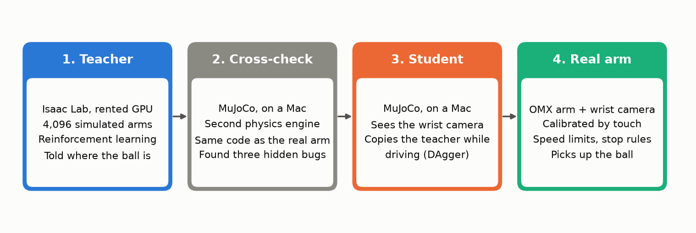
</picture>

## Abstract

I wanted to know whether a small hobby robot arm could learn a task entirely in simulation and then do it for real. The task is simple to say: find a foam golf ball with a camera on the wrist, pick it up, and lift it. The arm is a ROBOTIS OMX (five joints and a gripper). I trained a "teacher" policy with reinforcement learning in NVIDIA Isaac Lab that is told where the ball is, checked it in a second simulator (MuJoCo), and then trained small "student" networks on a Mac that only see the wrist camera's picture and copy the teacher.

In simulation the final teacher lifts the ball in 200 of 200 tries and still holds it at the end in 96%. The students lift it in 87.5 to 95.5% of tries from pictures alone. On the real arm, over three evenings, the ball was picked up in 7 of the 10 recorded attempts across three setups, including 2 of 3 attempts where a student drove the real arm by itself from live video. Those real numbers are far too small to be success rates. The most useful results are the things that broke on the way: a policy that depended on one servo stiffness, simulated fingers that were the wrong shape, an arm that slammed the desk at full speed, and a vision model that could not recognise the real ball because the real camera shows it in a different colour than I had simulated.

**Status in one line:** it works in simulation, it has worked a handful of times on the real arm, and it is not reliable yet. [Section 9](#9-limitations) lists what is not known.

## Contents

1. [Introduction](#1-introduction)
2. [Background, in plain words](#2-background-in-plain-words)
3. [Hardware](#3-hardware)
4. [Stage 1: a teacher that is told where the ball is](#4-stage-1-a-teacher-that-is-told-where-the-ball-is)
5. [Getting onto the real arm](#5-getting-onto-the-real-arm)
6. [Stage 2: a student that sees](#6-stage-2-a-student-that-sees)
7. [Results on the real arm](#7-results-on-the-real-arm)
8. [What went wrong, and what I learned](#8-what-went-wrong-and-what-i-learned)
9. [Limitations](#9-limitations)
10. [What comes next](#10-what-comes-next)
11. [Try it yourself](#11-try-it-yourself)
12. [Everything in this repository](#12-everything-in-this-repository)
13. [References](#13-references)

---

## 1. Introduction

Training a robot on the real machine is slow and breaks things. Training it in a simulator is fast: thousands of copies of the arm can practise at once on one graphics card. The catch is that a simulator is never exactly the real world, so a policy that is perfect in simulation can fail on the first real try. This is called the **sim-to-real gap**, and this project is one person's attempt to cross it with cheap hardware.

The question I set out to answer was:

> Can I train a policy in simulation that makes a real hobby arm find a ball with its own camera and pick it up, without ever training on the real arm?

The short answer so far is "yes, sometimes". The longer answer is this document. I tried to write down the failures as carefully as the successes, because the failures are where I learned how the gap actually shows up.

What I built, in order:

1. A **teacher**: a policy trained by trial and error in Isaac Lab on a rented GPU. It is told the ball's position as three numbers. It took three versions to get one that survives outside its own simulator.
2. A **cross-check** in MuJoCo, a different physics engine, running on a Mac through the exact code that drives the real motors. It caught three problems that the training simulator hid.
3. A **real-arm tool** with calibration, speed limits and safety stops, written after the first real attempt hit the desk.
4. **Students**: small networks that see the wrist camera's picture instead of being told where the ball is. They learn by copying the teacher. They were trained on a Mac mini for free.
5. **Real runs**: first with the ball's position typed in, then with a student's "eye" finding the ball, and finally with a student moving the arm by itself.

## 2. Background, in plain words

A few terms are used all the way through. None of them is complicated.

| Term | What it means here |
| --- | --- |
| **Policy** | A function that looks at what the robot senses and says how to move, 30 times a second. Here it is a small neural network. |
| **Reinforcement learning** | Learning by trial and error. The policy tries things in simulation and gets a score (a "reward") for doing well, and slowly changes itself to score higher. I used the PPO algorithm [1]. |
| **Teacher / student** | The teacher is trained the expensive way and is given privileged information (the ball's exact position). The student only gets what the real robot has (a camera picture) and learns to imitate the teacher. |
| **DAgger** | A way to train the student [2]. Instead of only watching the teacher, the student drives, makes its own mistakes, and the teacher says at every step what it would have done. This matters: when the student only watched, it lifted the ball 0 times in 61. |
| **Domain randomisation** | Making every simulated arm, ball, light and camera a bit different, so the policy cannot rely on details that will be different in reality [3]. |
| **Sim-to-real gap** | Whatever is different between simulation and the real world that makes a policy fail. |
| **Calibration** | Working out how the real arm's motor readings map onto the angles in the computer's model of the arm, and where the camera really is. |
| **Lifted / held** | In every table, "lifted" means the ball's centre ended more than 5 cm above the desk. On the real arm, where I cannot see the ball's height, "held" means the fingers were stopped by something between them while the gripper went up. |

## 3. Hardware

| Part | What I used |
| --- | --- |
| Arm | ROBOTIS OMX follower: five joints plus a gripper. Three DYNAMIXEL XL430-W250 servos (the base swivel, shoulder and elbow) and three XL330-M288 (wrist bend, wrist roll, gripper). |
| Camera | A USB camera fixed to the wrist, 1280 x 720. Its listing says a 102 degree lens; I measured 67 degrees (a focal length of 975 pixels). |
| Ball | An orange foam practice golf ball, 42.7 mm across. |
| Computer at the arm | A MacBook Air. It runs the policy on its processor; no GPU is needed to *run* anything. |
| Training, teacher | One rented NVIDIA L40S GPU with Isaac Lab 3.0.0 (Isaac Sim 6.0.1). |
| Training, students | A Mac mini (M4, 16 GB), no GPU rental. |

The camera rides on the gripper and looks along it. That choice has a cost I only understood later: when the gripper is down near the desk, the camera sees a small patch of desk, and a ball more than about 19 cm away is partly or wholly out of the picture ([Section 7](#7-results-on-the-real-arm)).

## 4. Stage 1: a teacher that is told where the ball is

### 4.1 Setup

The teacher is trained in Isaac Lab [4] with 4,096 simulated arms practising at once. It is a small network (three layers of 256, 128 and 64 units) trained with PPO from the RSL-RL library [5]. Thirty times a second it reads 33 numbers (joint angles and speeds, the ball's position, where to hold the ball, and what it did last step) and outputs 6 numbers (how to move each of the five arm joints, and whether to open or close the gripper).

I started with an easier task, **reaching** a point in space, to check the pipeline. That policy reached within 2 cm on 5,000 of 5,000 tries with a typical error of 1 mm, in 566 seconds of training ([details](results/reach/2026-11-24-baseline/README.md)). It also gave the first warning: with servos six times stiffer than it was trained on, its typical error went from 1 mm to 11 mm. I did not yet know that would matter.

### 4.2 Three pickup policies, two of which failed

The pickup task: a ball sits on the desk in front of the arm, and the arm must lift it and hold it 10 to 16 cm up within five seconds.

| Version | What changed | In its own simulator (Isaac Lab) | In the second simulator (MuJoCo) | Verdict |
| --- | --- | --- | --- | --- |
| [First](results/pickup/2026-11-24-first/README.md) | All simulated arms identical | Lifted 100%, held at target 88.9% | Not tested there. With servos 6x stiffer in Isaac Lab: lifted **6%** | Depends on one servo stiffness. Would probably fail on hardware |
| [Second](results/pickup/2026-11-24-varied/README.md) | Every arm, ball and camera different; ball position given late and slightly wrong, like a camera would | Lifted 92.1% | Lifted at some point 71.5%, still holding at the end **3.5%** | Picks the ball up and drops it |
| [Third ("claw")](results/pickup/2026-11-24-claw/README.md) | Fingers given their real hollow claw shape; a new way of commanding the joints | Lifted 80.7%, held at target 66.2% (2,000 tries) | Lifted **100%**, still holding at the end **96.0%** | The one used for everything after this |

<picture>
  <source media="(prefers-color-scheme: dark)" srcset="docs/figures/teacher-second-simulator-dark.png">
  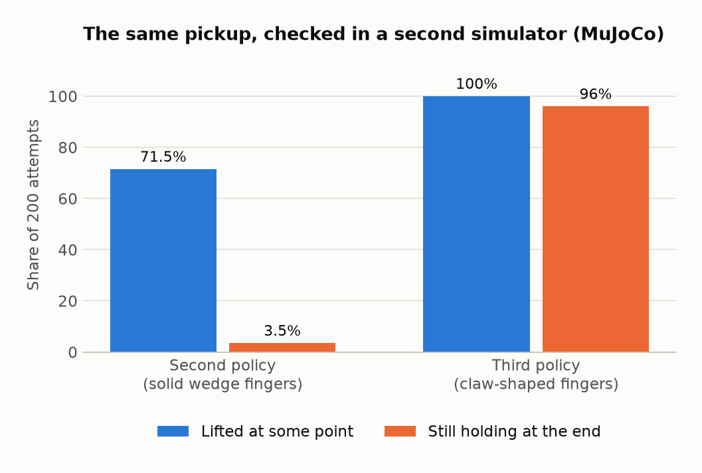
</picture>

*Figure 1. The second and third pickup policies in MuJoCo, 200 attempts each. The only big change between them was the shape of the simulated fingers.*

The third policy picking up the ball in MuJoCo (the clip plays three attempts; [full video](results/pickup/2026-11-24-claw/mujoco-pickup.mp4)):

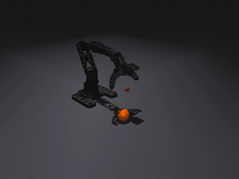

For comparison, the first policy in Isaac Lab ([full video](results/pickup/2026-11-24-first/pickup.mp4)). It looks just as good, and it would not have worked:

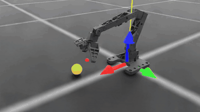

### 4.3 Why I checked in a second simulator

Isaac Lab cannot run on a Mac, and I did not want to trust one simulator. So I ran each exported policy in MuJoCo [6], on the arm maker's own model, through the same code that later drove the real servos. This check found three things that training alone hid:

1. **The first policy relied on one servo stiffness.** It had learned to aim past its target by exactly the amount the simulated servo would fall short. A different servo breaks that trick.
2. **The training ball was too reluctant to roll.** I had damped it to imitate foam. With the same damping in MuJoCo an earlier version's lift rate went from 35% to 80%, which told me the policy had learned to expect a ball that stays put.
3. **The simulated fingers were the wrong shape.** Physics engines simplify shapes to their outer hull. The real fingers are thin curved claws that close around a ball; their hulls are solid wedges (39.5 cm³ instead of 9.8 cm³) that can only pinch it at the tips. With hull fingers the third policy keeps the ball in 1 try out of 200. With claw-shaped fingers, 192 out of 200.

It also found a bug in the check itself (my simulated servo froze during a command delay, which a real one does not).

### 4.4 An honest note about the teacher

The teacher used everywhere below is the checkpoint after **1,500 of a planned 4,000** training iterations (about 39 minutes). The rented machine ran out of credit a few minutes before the run finished, and the final checkpoint is still on its stopped disk. So every student in this project learned from a half-trained teacher.

## 5. Getting onto the real arm

### 5.1 Calibrating by touch

The arm's motors report positions in their own units, and my arm's zero points had been rewritten by another tool; the elbow was 88 degrees off. I did not want to trust my eye, so the calibration works by touch: with the motors off, I rest the closed gripper's tip on a ruler at known distances from the base, and the program fits the zero points that make the computer's model put the tip where it really is. From four touches the typical error was 3.6 mm and the worst 5.3 mm.

### 5.2 The first attempt hit the desk

On 25 November I ran the teacher on the real arm for the first time, with the ball's position typed in. **It failed, and it was my fault.** The policy moves as fast as the servos allow (about 330 degrees a second at its peak). The arm hit the desk and closed on nothing. Then a bug in my tool let the servos' safety timer expire while the arm was raised, the motors cut out, and the arm dropped. Nothing was damaged.

What I changed before trying again:

- **Speed limits.** Joint targets may move at most 0.3 rad/s (about 17 degrees a second) and may sit at most 0.05 rad ahead of the joint.
- The tool never waits on the keyboard while the motors are on, always lowers the arm before switching off, and records every step to a file.
- Every powered command starts only when I say so.

The second attempt, with the limits, picked the ball up and held it for about 6.5 seconds, until I knocked it out by hand.

### 5.3 Slowing down broke the policy, and facing the ball fixed it

The teacher was never trained to move slowly. With the speed limits on, its success in simulation fell from 99.0% to 61.5%, and the failures were one-sided: balls to the right of centre were almost never lifted. I could not retrain it (no GPU credit), so I worked around it. The arm is the same whichever way its base points, so before every pickup the arm now **turns to face the ball**, putting it 3 cm to the left of straight ahead, where the slowed-down policy is reliable.

<picture>
  <source media="(prefers-color-scheme: dark)" srcset="docs/figures/speed-limits-and-facing-dark.png">
  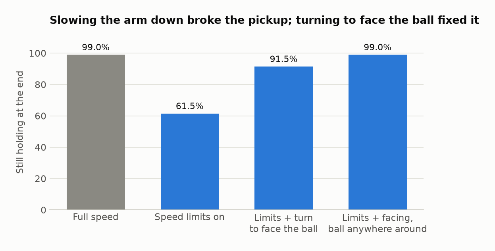
</picture>

*Figure 2. The teacher in MuJoCo with the ball's position coming from the simulated wrist camera, 200 attempts per bar. The grey bar is the speed that hit the desk.*

This also means the arm can pick up a ball anywhere around it, not only straight ahead. How far away the ball can be was then measured, and the arm refuses anything outside 15 to 24 cm:

<picture>
  <source media="(prefers-color-scheme: dark)" srcset="docs/figures/reach-by-distance-dark.png">
  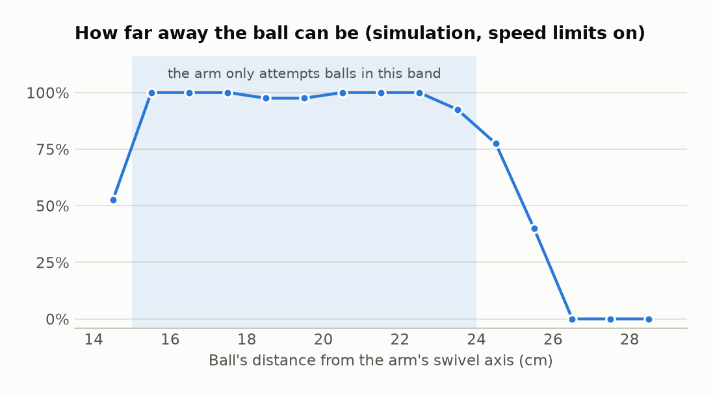
</picture>

*Figure 3. Lift rate by the ball's distance, 40 simulated attempts per centimetre, speed limits on ([data](results/camera/2026-11-25-wrist-camera/README.md)).*

### 5.4 The wrist camera

To find the ball I first wrote a finder by hand ([details](results/camera/2026-11-25-wrist-camera/README.md)): it looks for the ball's colour, checks the patch is round and the right size, and uses the fact that the ball rests on the desk to work out where it is from one picture. The camera is calibrated without measuring anything by hand. I put the ball down, and the arm looks at it from about twenty poses it chooses itself, then fits the lens and where the camera sits on the wrist. On the real arm this used 19 sightings and agreed with itself to 1.5 mm.

Two practical lessons:

- **The lens was not what the listing said.** The first simulated camera used the advertised 102 degree lens. The real one is 67 degrees. A whole training run on the wrong lens was thrown away.
- **From the lowered start pose the camera sees too little.** It shows, whole, only 43% of the places a ball can be picked up from. So the arm first rises to a **look pose**, where it sees all of them within about 35 degrees either side, and swivels left and right if it sees nothing.

### 5.5 Carrying the ball to a bowl (simulation only)

After the pickup the arm can carry the ball to a cereal bowl at its side and drop it in. This is a fixed, slow move, not a learned one. In MuJoCo, of 198 balls lifted in 200 attempts, all 198 ended in the bowl ([details](results/carry/2026-11-26-bowl/README.md)). Putting a bowl in the scene also revealed that the teacher swings up to 42 degrees to its right while lifting, so the bowl has to stand on the arm's left. **This has not been run on the real arm.** The clip is sped up six times ([full video](results/carry/2026-11-26-bowl/mujoco-pickup-and-carry-to-bowl.mp4)):

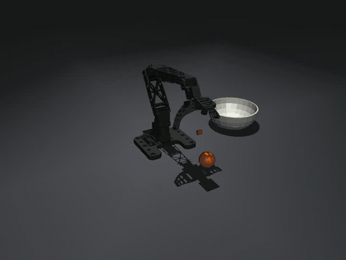

## 6. Stage 2: a student that sees

The teacher is told where the ball is. A real robot is not. The goal of this stage was a network that gets only the camera picture and the arm's own joint readings, and does the whole pickup.

### 6.1 The network

The student is small on purpose, so it can run on a laptop:

- **Input:** the wrist camera's picture shrunk to 128 x 72, and 20 numbers about the arm's joints.
- **Picture part:** four convolution layers, then a "soft arg-max" that turns each of 64 feature maps into *where* in the picture it fires [7]. That suits a question like "where is the ball".
- **Memory:** a GRU (a small recurrent layer), so it remembers where the ball was after the gripper hides it.
- **Output:** how to move the five joints, whether to close the gripper, and two guesses of where the ball is (one from the current picture alone, one from memory) plus how sure it is that the ball is in view.
- **Size:** about 228,000 weights. One step takes about 4 ms on the MacBook Air; a control step lasts 33 ms.

The closest standard design is the recurrent imitation policy "BC-RNN" from the robomimic benchmark [8], only much smaller.

### 6.2 Training

Each student trains for eight rounds of DAgger in MuJoCo. In each round the simulated arm makes 120 to 160 attempts under the real arm's speed limits, more and more of them driven by the student, while the teacher's answer is recorded at every step. Then the student trains on everything gathered so far. One run takes about 94 minutes on the Mac mini.

Every attempt looks different: desk colour and pattern, lighting, glare, haze over the lens, exposure, blur, noise, picture delay, other objects on the desk (including red and orange ones), and a camera slightly off from where calibration put it.

| Round | Teacher drove: lifted | Student drove: lifted |
| --- | --- | --- |
| 0 | 159 of 160 | |
| 1 | 57 of 59 | 0 of 61 |
| 2 | 33 of 33 | 23 of 87 |
| 3 | 20 of 20 | 7 of 100 |
| 4 | 12 of 12 | 82 of 108 |
| 5 | | 90 of 120 |
| 6 | | 89 of 120 |
| 7 | | 106 of 120 |

*Table 1. The first student's training ([stage A](results/student/2026-11-26-stage-a/README.md)). Round 1 is the student after only watching the teacher: it lifted nothing.*

### 6.3 The gap was one colour

The first student did reasonably in simulation (72.5% lifted from pictures alone, against the teacher's 97.5%). On 65 real pictures of the ball it was **sure the ball was there in only 18**.

I expected the problem to be picture quality: clutter, glare, a cheap renderer. It was none of those. I changed one thing at a time in the real pictures to find out:

| Change made to the real picture | Sure the ball is there (of 19) |
| --- | --- |
| Nothing | 3 |
| **Ball repainted plain orange** | **17** |
| Ball's colour made 1.6 times stronger | 13 |
| Whole picture 20% darker | 7 |
| Haze removed from the whole picture | 2 |

The real camera overexposes the ball. In all 65 real pictures the ball is a **pale peach** (red 255, green about 185, blue about 131), not the strong orange of the real object. Only 5% of my simulated balls looked like that. Geometry, clutter and glare had carried over from simulation fine. One colour had not.

### 6.4 Two fixes, and a third student to tell them apart

I tried two fixes at the same time:

- **Fix the simulation:** show the simulated ball in the colour the real camera gives it.
- **Remove the colour question:** pass every picture, real or simulated, through one fixed colour filter that marks "ball-coloured" pixels, and show the student that black-and-white **mask** instead of the colour picture. The same code filters real and simulated pictures, so the student never has to learn what colour the ball is.

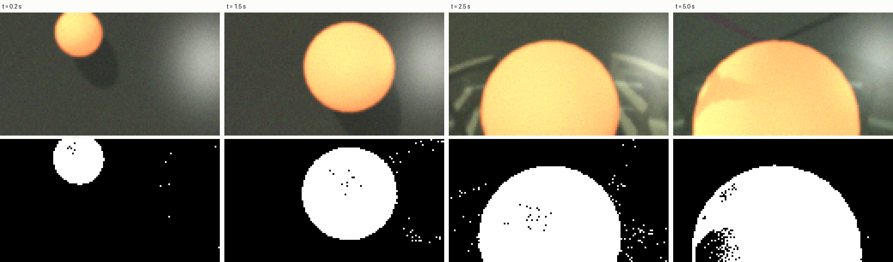

*Figure 4. One simulated attempt through the wrist camera (top) and after the colour filter (bottom), as the ball gets closer and is grasped. The animated version:*

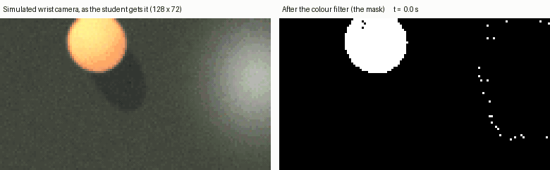

And the same filter on a picture from the real camera:

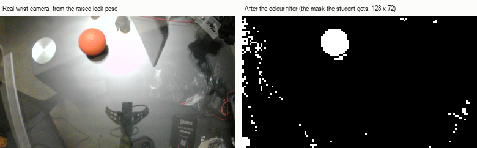

*Figure 5. A real picture from the look pose (26 November) and what the filter makes of it. The ball becomes a clean disc. The specks are other things on the desk that pass the same colour test, which is why the mask-alone student is the easiest of the three to fool (Table 2).*

That gave three students, trained the same way from the same starting point, that differ **only in what they are shown**:

| Student | What it is shown |
| --- | --- |
| [Colour](results/student/2026-11-26-real-ball-colour/README.md) | The colour picture, with the simulated ball recoloured |
| [Mask beside grey](results/student/2026-11-26-mask-and-grey/README.md) | The filter's mask next to a grey version of the picture |
| [Mask alone](results/student/2026-11-26-mask-alone/README.md) | Only the filter's mask |

<picture>
  <source media="(prefers-color-scheme: dark)" srcset="docs/figures/real-pictures-dark.png">
  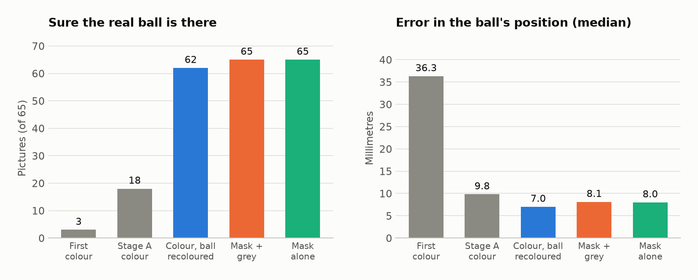
</picture>

*Figure 6. Five students on the same 65 real pictures. Position error is over the 19 pictures where the ball's place is known. The two grey bars are the students from before the colour was understood.*

<picture>
  <source media="(prefers-color-scheme: dark)" srcset="docs/figures/three-students-dark.png">
  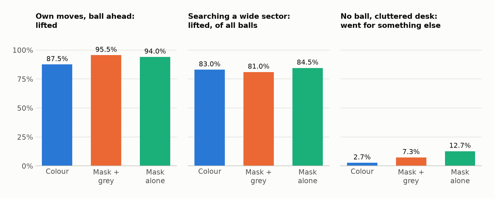
</picture>

*Figure 7. The three students in simulation, 200 attempts per bar (150 for the no-ball searches).*

| | Colour | Mask beside grey | Mask alone |
| --- | --- | --- | --- |
| Own moves, ball ahead: lifted | 87.5% | 95.5% | 94.0% |
| Searching 57 degrees either side: lifted, of all balls | 83.0% | 81.0% | 84.5% |
| Searching: refused to try | 6.5% | 14.0% | 9.5% |
| No ball, cluttered desk: said there was a ball | 21.3% | 29.3% | 44.7% |
| No ball: went on to attempt a pickup | 2.7% | 7.3% | 12.7% |
| Real pictures: sure the ball is there (of 65) | 62 | 65 | 65 |
| Real pictures: median position error | 7.0 mm | 8.1 mm | 8.0 mm |
| Real pictures: worst position error | 11.9 mm | 24.0 mm | 19.9 mm |

*Table 2. The numbers behind Figures 6 and 7.*

What I take from this:

- **Both fixes work.** All three students recognise the real ball. Since the recoloured ball was in all three training sets, the filter was not strictly needed. Neither fix needed a better renderer.
- **I cannot rank them on pickup rate.** There is one training run of each, and two runs of the same recipe have differed by 15 points before.
- **The less a student is shown, the easier it is to fool.** With no ball on a cluttered simulated desk, the mask-alone student went for something else in 12.7% of searches, against 2.7% for the colour student. A second round, ball-sized orange patch can move the mask-alone student's answer by several centimetres while it stays 100% sure; the other two move by millimetres.

### 6.5 Two ways to use a student, and why picture delay matters

A trained student can be used in two ways at the arm:

- **Its eye only.** The student looks once from the look pose and says where the ball is. Then the *teacher* does the pickup using that position.
- **Driving itself.** The student moves the arm from start to finish from live video, correcting as it goes.

On the same simulated balls, the eye-only route lifted 78.0% and the student driving itself lifted 95.5%. One still estimate is about 9 mm off, and the slowed-down teacher needs the position to a few millimetres. A student that keeps looking fixes its own error on the way down.

But driving from video only works if the pictures are fresh:

<picture>
  <source media="(prefers-color-scheme: dark)" srcset="docs/figures/picture-lateness-dark.png">
  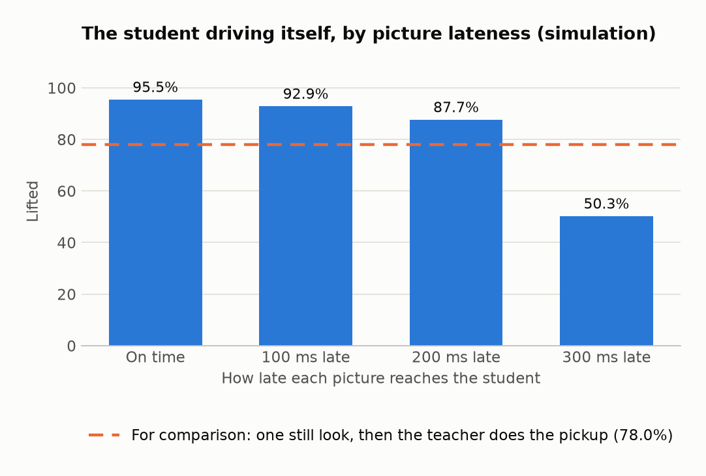
</picture>

*Figure 8. The mask-beside-grey student driving itself in simulation, by how late each picture arrives. It was trained on pictures up to 100 ms late.*

The student has no way of noticing that its pictures are late, so the delay of the real camera has to be measured before trusting it. I have a tool for that (`scripts/stream_lateness.py`) and have not run it yet.

## 7. Results on the real arm

Everything above is simulation or saved pictures. This section is the real arm. **The counts are tiny and should be read as "it can work", not "it works this often".**

<picture>
  <source media="(prefers-color-scheme: dark)" srcset="docs/figures/real-arm-runs-dark.png">
  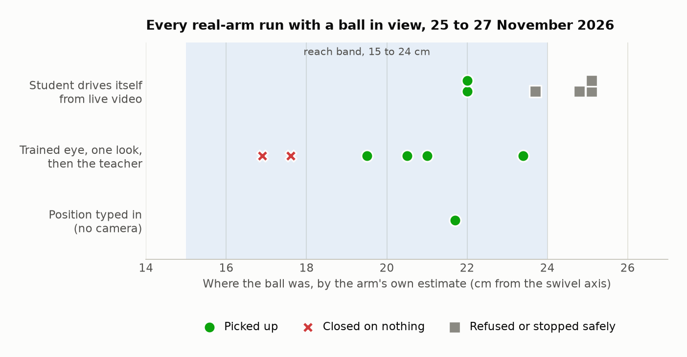
</picture>

*Figure 9. Every recorded real-arm run in which the arm saw a ball. The shaded band is where the arm is willing to try.*

| How the arm knew where the ball was | Model | Pickups attempted | Lifted and held |
| --- | --- | --- | --- |
| Position typed in (25 Nov) | Teacher | 1 (plus the unrecorded first attempt that hit the desk) | 1 |
| Trained eye looks once, teacher picks up (26 Nov) | Mask beside grey | 6 | 4 |
| Student drives itself from live video (27 Nov) | Mask alone | 3 | 2 |

*Table 3. Real-arm pickups. [The full list of 15 runs, with a recording of each](results/real-arm/2026-11-27-first-vision-runs/README.md).*

The first time a student drove the real arm, it picked the ball up:

<picture>
  <source media="(prefers-color-scheme: dark)" srcset="docs/figures/real-live-run-dark.png">
  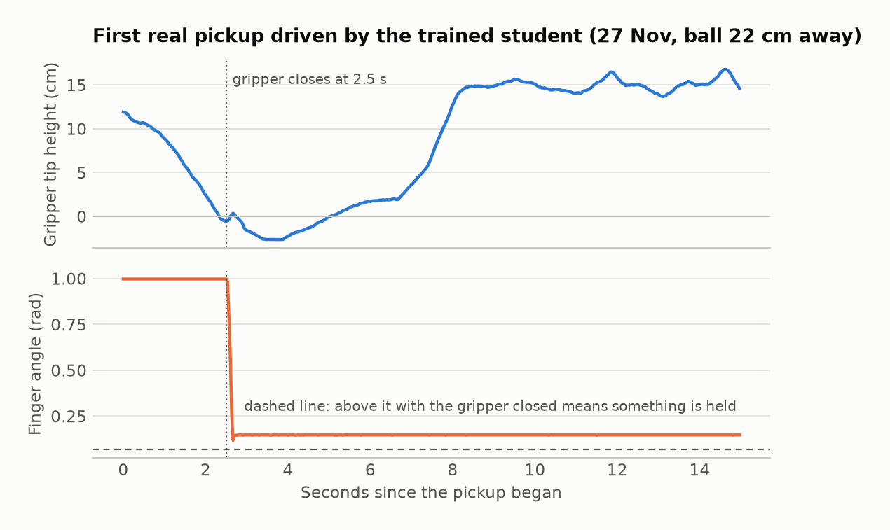
</picture>

*Figure 10. The recording of that run (27 November, 01:11). The gripper comes down, closes at 2.5 s, and the fingers stay stopped at 0.15 rad for the rest of the run, which means something is between them, while the tip rises to about 15 cm.*

This is what the student was shown during that run, and what the filter made of it:

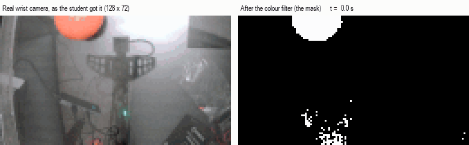

*The same run through the wrist camera, at real speed: the 150 pictures that arrived in 15 seconds, at the 128 by 72 size the student gets. The ball is found and grasped while it is orange. From about 5 s, with the ball held right in front of the lens, the picture turns blue-green and the ball pink, the filter loses it, and the student's sureness falls from 1.00 to 0.00 while it goes on holding.*

What the recordings say beyond the counts:

- **The two misses were the two nearest balls** (16.9 and 17.6 cm). Everything from 19.5 cm out was picked up. In simulation near balls are the *easiest* for this setup, so this is a real-world effect I have not explained.
- **In both misses the arm went where it was told** and closed on empty air. So the suspect is the position it was given, or a few millimetres of error in the arm's own geometry when it is folded in close. A direct check (find the ball, then touch it with the gripper) is still to do.
- **The student's far limit on the real arm is the camera's view, and the slow video.** From the lowered start pose a ball at 23.7 cm is mostly out of the picture (in simulation about 38% of it shows, against 89% at 22 cm). The student was 0% sure on every step and stopped itself after 0.6 s, which is the stop rule working. In simulation this does not end the attempt: the arm moves, the ball comes into view inside those 20 steps, and the mask-beside-grey student lifted 28 of 28 balls between 23.2 and 24.9 cm (the mask-alone student, which is the one that ran here, was not tried on that set). On the real arm 20 steps is only six or seven pictures, so the likeliest reading is that the view did not catch up in time. That is an inference; the pictures from that run were not kept.
- **The live video arrived at 10 pictures a second, not the 30 the student was trained on.** It picked the ball up twice anyway.
- **The student stops recognising the ball once it is holding it.** In the run above its sureness is 0.00 from 6 to 9 s and averages 0.34 after that, because the picture's colours shift (most likely the camera rebalancing its colours when the ball fills the view; I have not tested that). Nothing in simulation does this. It did not matter here, because the stop rule only applies while the gripper is open and the lift does not need the ball in view. It may matter for anything the arm has to do with the ball after picking it up.
- **The gripper pushes about 2 cm "into" the desk** by the arm's own readings, in the teacher's runs and the student's. The teacher asks for that in simulation too, where the desk is rigid. On the real arm something gives.
- **The wrist stops bending back at about 10 degrees** on every lift; in simulation it goes to 97. I do not yet know whether the camera, its cable or the joint stops it.

There is no video of the real arm from the outside yet. Of the pictures the camera took during these runs, only the two shown in this README are in the repository.

## 8. What went wrong, and what I learned

| What went wrong | How I found it | What I changed | Lesson |
| --- | --- | --- | --- |
| First policy only worked for one servo stiffness (100% to 6%) | Stress tests in Isaac Lab | Varied every simulated arm; changed how joints are commanded | A policy will use any regularity the simulator offers |
| Second policy picked the ball up and dropped it (3.5% held) | Second simulator | Gave the fingers their real claw shape | Check collision shapes, not just how the model looks |
| The arm hit the desk at full speed, then dropped | First real run | Speed limits, safety timer handling, always lower before power off | Never run a policy on hardware at the speed it was trained at without a limit |
| The slowed policy failed for balls on the right (61.5%) | MuJoCo with the limits on | Turn the arm to face the ball first (99.0%) | A limit added afterwards changes the task. It belongs in training |
| The first simulated camera had the wrong lens (102 vs 67 degrees) | Calibrating the real camera | Used the measured camera; discarded a training run | Measure the real sensor before simulating it |
| Four camera calibrations failed | Each one, at the arm | The laptop now speaks one instruction at a time, from live feedback | Long written instructions do not work when your hands are on a robot |
| The first student could not recognise the real ball (18 of 65) | Changing one thing at a time in real pictures | Recoloured the simulated ball; added the filter | Find the *actual* gap before paying to close an assumed one |
| A watching-only student lifted nothing (0 of 61) | Round 1 of training | DAgger: the student drives and is corrected | Imitation needs the student's own mistakes in the data |
| The mask-only student can be fooled by another orange object | A "no ball" test in simulation | Kept other orange things out of view; added an optional second check | A simpler input is easier to transfer and easier to fool |
| My run log scored a pickup as a miss because the ball was knocked out before the end | I knew the ball had been gripped; the recording agreed | Score a run from the whole recording, not its last step | Decide what "success" means from the data, and check the scorer |

## 9. Limitations

I would not want anyone to read more into this than is there.

- **The real-arm numbers are a handful of runs.** 7 pickups in 10 recorded attempts over three setups, with one ball, one desk and one room.
- **Nothing was a blind test.** The filter and the simulated ball's colour were chosen after looking at the same real pictures the students are scored on.
- **One training run per student.** Differences of a few points between them mean little.
- **The teacher is half-trained** (1,500 of 4,000 iterations) and was never trained with the speed limits the real arm needs.
- **The camera's picture delay is unmeasured**, and its live rate is 10 pictures a second, a third of what the students were trained on.
- **How accurate the arm's calibration is with the arm raised is unknown.** The camera's calibration depends on it.
- **Two real-arm effects are unexplained:** the misses on near balls, and whatever stops the wrist.
- **The bowl carry has only run in simulation.**
- **The simulated ball is a rigid sphere.** Real foam squashes.
- **No video of the real arm.** The evidence for real pickups is the arm's own recorded readings.

## 10. What comes next

1. Measure the live camera's delay and get it back to 30 pictures a second (likely by asking the camera for smaller pictures).
2. The find-then-touch test, to see whether near-ball misses come from the eye, the camera calibration or the arm.
3. Find out what stops the wrist.
4. Film the real arm.
5. Run the bowl carry on the real arm.
6. **Stage B:** retrain the teacher on a GPU with the speed limits and the real wrist travel built in, then train the final student from it. Stage A (everything in Section 6) was done for free on purpose, to find out what the paid training has to get right. [The list of 15 things it must carry over](results/student/2026-11-26-stage-a/README.md#what-stage-b-has-to-carry-over) is the main output of that stage.

## 11. Try it yourself

You need Python 3.11 or newer. Nothing in this section needs a GPU or a robot.

The repository is `physical-ai-research`; Understudy is the project in it, and the Python package is still `understudy`. The repository was named `understudy` on GitHub until 27 November 2026, and the old address redirects here.

```sh
git clone https://github.com/ichen27/physical-ai-research.git
cd physical-ai-research
python3 -m venv .venv && . .venv/bin/activate
bash ci/run.sh                      # installs the test requirements and runs all the checks
```

Watch the teacher pick up a ball in MuJoCo and score it over 200 attempts:

```sh
python scripts/mujoco_pickup.py --policy results/pickup/2026-11-24-claw/policy.onnx --attempts 200
python scripts/mujoco_pickup.py --policy results/pickup/2026-11-24-claw/policy.onnx --attempts 3 --video pickup.mp4
```

Train a student yourself (about 95 minutes on an Apple-silicon Mac) and measure it:

```sh
pip install -r requirements-dev.txt -r requirements-train.txt
python scripts/train_student.py --data /tmp/student-data --out out --rounds 8 --input mask
python scripts/evaluate_student.py --student out/student.pt --rows teacher student --output-dir out
```

Redraw the charts in this README:

```sh
pip install matplotlib numpy
python docs/figures/make_figures.py
```

Training the teacher needs a Linux machine with an NVIDIA RTX GPU and Isaac Lab 3.0. Running the real arm needs the arm, and a lot of care. Both are covered step by step in **[the manual](docs/MANUAL.md)**, which also explains every command of the real-arm tool, the calibration procedure, and what has to be clear around the arm.

**Validation.** `bash ci/run.sh` runs the unit tests and compiles every Python file; the same command runs in CI on every pull request. It does not start Isaac Lab or touch hardware.

## 12. Everything in this repository

### Results, one folder per experiment

Each folder has its own write-up with every number, the exact commands, and the raw measurement files.

| Folder | What it is | Where it ran |
| --- | --- | --- |
| [results/reach/2026-11-24-baseline](results/reach/2026-11-24-baseline/README.md) | First policy: reaching a point | Isaac Lab |
| [results/pickup/2026-11-24-first](results/pickup/2026-11-24-first/README.md) | First pickup policy (stiffness problem) | Isaac Lab |
| [results/pickup/2026-11-24-varied](results/pickup/2026-11-24-varied/README.md) | Second pickup policy (drops the ball) | Isaac Lab, MuJoCo |
| [results/pickup/2026-11-24-claw](results/pickup/2026-11-24-claw/README.md) | Third pickup policy: **the teacher** | Isaac Lab, MuJoCo |
| [results/camera/2026-11-25-wrist-camera](results/camera/2026-11-25-wrist-camera/README.md) | Finding the ball with the wrist camera; facing the ball; the reach band | MuJoCo |
| [results/carry/2026-11-26-bowl](results/carry/2026-11-26-bowl/README.md) | Carrying the ball to a bowl | MuJoCo |
| [results/student/2026-11-26-stage-a](results/student/2026-11-26-stage-a/README.md) | First student; the colour finding; what Stage B must carry over | MuJoCo, real pictures |
| [results/student/2026-11-26-real-ball-colour](results/student/2026-11-26-real-ball-colour/README.md) | Colour student | MuJoCo, real pictures |
| [results/student/2026-11-26-mask-and-grey](results/student/2026-11-26-mask-and-grey/README.md) | Mask-beside-grey student; the two wirings; picture delay; false finds | MuJoCo, real pictures, real arm |
| [results/student/2026-11-26-mask-alone](results/student/2026-11-26-mask-alone/README.md) | Mask-alone student; the three compared | MuJoCo, real pictures, real arm |
| [results/real-arm/2026-11-27-first-vision-runs](results/real-arm/2026-11-27-first-vision-runs/README.md) | **Every real-arm run**, with a recording of each | Real arm |

### Trained models

| Model | Files | Use it with |
| --- | --- | --- |
| Teacher | `results/pickup/2026-11-24-claw/policy.onnx` (+ `interface.json`) | `understudy.runtime.OnnxPolicy`; ONNX Runtime |
| Students | `results/student/<name>/student.pt` (PyTorch), `eye.onnx` and `driver.onnx` (for the arm, no PyTorch needed) | `understudy.eye.Eye`, `understudy.eye.Driver` |

### Media

| File | What it shows |
| --- | --- |
| `results/pickup/2026-11-24-claw/mujoco-pickup.mp4` | The teacher in MuJoCo, three attempts |
| `results/pickup/2026-11-24-first/pickup.mp4`, `results/pickup/2026-11-24-varied/pickup.mp4` | The first two pickup policies in Isaac Lab |
| `results/pickup/2026-11-24-varied/mujoco-pickup.mp4` | The second policy losing the ball in MuJoCo |
| `results/carry/2026-11-26-bowl/mujoco-pickup-and-carry-to-bowl.mp4` | Pickup and carry to the bowl, at real speed |
| `docs/media/*.gif` | The animations shown in this README, made from those videos and from a saved simulated attempt |
| `docs/media/real-look-and-filter.png`, `docs/media/real-student-view.gif` | A real wrist-camera picture and the pictures from the first student-driven pickup, each beside the filter's mask. Drawn by `docs/media/make_real_media.py` from pictures that are not in the repository |
| `docs/figures/*.png` | The charts in this README (light and dark versions), drawn by `docs/figures/make_figures.py` |

### Code

| Path | Purpose |
| --- | --- |
| `understudy/` | The library: the arm's description, kinematics, the policy's inputs and outputs, the servo driver, the camera model and calibration, the students, and the code that runs a policy on an arm (simulated or real) |
| `understudy_isaac/` | The Isaac Lab tasks and training settings |
| `scripts/` | Training, evaluation, the MuJoCo checks, and `real_arm.py`, the tool for the real arm |
| `tests/` | Checks that run without a simulator or an arm |
| `docs/MANUAL.md` | The full manual, including a file-by-file layout |

### Contributing

Issues and pull requests are welcome. Please run `bash ci/run.sh` first, and say whether a change was tested in simulation, on a real arm, or neither. For simulation problems, include your Isaac Lab version.

### License

MIT. See [LICENSE](LICENSE). The arm model under `assets/open_manipulator_description/` is from ROBOTIS under Apache-2.0; see [THIRD_PARTY_NOTICES.md](THIRD_PARTY_NOTICES.md).

## 13. References

1. J. Schulman, F. Wolski, P. Dhariwal, A. Radford, O. Klimov. *Proximal Policy Optimization Algorithms.* 2017. [arXiv:1707.06347](https://arxiv.org/abs/1707.06347)
2. S. Ross, G. Gordon, J. A. Bagnell. *A Reduction of Imitation Learning and Structured Prediction to No-Regret Online Learning* (DAgger). AISTATS 2011. [arXiv:1011.0686](https://arxiv.org/abs/1011.0686)
3. J. Tobin, R. Fong, A. Ray, J. Schneider, W. Zaremba, P. Abbeel. *Domain Randomization for Transferring Deep Neural Networks from Simulation to the Real World.* IROS 2017. [arXiv:1703.06907](https://arxiv.org/abs/1703.06907)
4. M. Mittal et al. *Orbit: A Unified Simulation Framework for Interactive Robot Learning Environments* (the framework that became Isaac Lab). 2023. [arXiv:2301.04195](https://arxiv.org/abs/2301.04195)
5. N. Rudin, D. Hoeller, P. Reist, M. Hutter. *Learning to Walk in Minutes Using Massively Parallel Deep Reinforcement Learning* (RSL-RL). CoRL 2021. [arXiv:2109.11978](https://arxiv.org/abs/2109.11978)
6. E. Todorov, T. Erez, Y. Tassa. *MuJoCo: A physics engine for model-based control.* IROS 2012.
7. S. Levine, C. Finn, T. Darrell, P. Abbeel. *End-to-End Training of Deep Visuomotor Policies.* JMLR 2016. [arXiv:1504.00702](https://arxiv.org/abs/1504.00702)
8. A. Mandlekar et al. *What Matters in Learning from Offline Human Demonstrations for Robot Manipulation* (robomimic). CoRL 2021. [arXiv:2108.03298](https://arxiv.org/abs/2108.03298)
