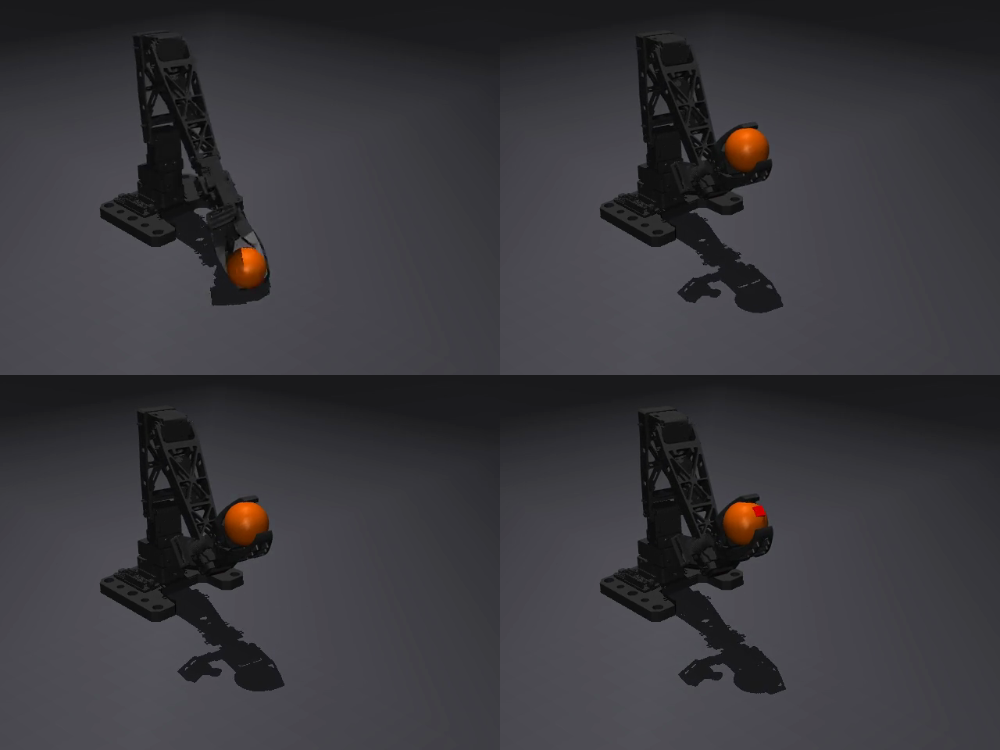

# Understudy

Train a small robot arm in simulation, then run the trained policy on the real arm.



The arm is the ROBOTIS OMX follower (five joints plus a gripper, DYNAMIXEL XL430 and XL330 servos). Policies are trained with reinforcement learning in NVIDIA Isaac Lab on a rented GPU and are meant to run on the physical arm from a laptop.

## Status

This is an early project. Read this section before relying on anything.

| Part | State |
| --- | --- |
| Arm description, unit conversions, calibration format | Working, tested |
| Forward kinematics read from the vendor URDF | Working, tested. Matches the simulator to 0.00 mm |
| Isaac Lab reach task (`understudy_isaac/`) | Working in Isaac Lab 3.0.0 |
| Trained reach policy | Trained and measured **in simulation only**. See [results](results/reach/2026-11-24-baseline/README.md) |
| Ball pickup task | Working in Isaac Lab 3.0.0 |
| Trained pickup policy | Holds the ball in two simulators. **Not yet tried on a real arm.** See [results](results/pickup/2026-11-24-claw/README.md) |
| Cross-check in a second simulator (MuJoCo, vendor arm model) | Working, no GPU needed |
| Real-arm runner and calibration tool | Written and tested against a simulated arm. On the real arm it has picked the ball up once, with speed limits, after a failed first attempt (see [Real arm](#real-arm)) |
| Carrying the ball to a bowl and dropping it in | A fixed move after the pickup, measured **in MuJoCo only**: every ball lifted ended in the bowl. Not run on the real arm (see [Carrying the ball to a bowl](#carrying-the-ball-to-a-bowl)) |
| A pickup policy that sees the camera's picture instead of being told where the ball is | A first one, trained on a Mac to find out what the paid training must get right. In MuJoCo it lifts about 70% against the told policy's 98%; on real pictures it places the ball to about 1 cm but is sure of it in only 18 of 65, because the real camera shows the ball a colour the simulated pictures lacked. **Not run on the real arm.** See [results](results/student/2026-11-26-stage-a/README.md) |
| Locating the ball with the camera on the wrist | Detector, calibration and pickup written and tested on saved pictures and in MuJoCo. **On the real arm only the read-only `look` step has run**: the camera is not yet calibrated there and no real pickup has used it (see [Wrist camera](#wrist-camera)) |

In simulation the first policy reached within 2 cm on 5,000 of 5,000 scored reaches, with a median error of 1 mm. With servos six times stiffer or 2.5 times softer than it was trained on, it still reached within 2 cm every time, but the median error rose to 7–11 mm. Nothing has been run on a real arm yet.

The current pickup policy is trained on the vendor's servo model with every simulated arm, ball and camera different, and with the gripper fingers given their real claw shape. Run in a second simulator, on the vendor's own model of the arm, it lifts the ball in 200 of 200 attempts and still holds it at the end in 96%. It holds the ball 3–4 cm from the requested point, not on it, and nothing has been tried on a real arm. It is the checkpoint from 1,500 of a planned 4,000 training iterations; the rest of that run is on a rented machine that stopped when its credit ran out.

Getting there took three corrections that only showed up in the second simulator: the first policy depended on one servo stiffness, the training ball was too reluctant to roll, and the simulated fingers were solid wedges where the real ones are hollow claws.

Known limitations:

- The servo values in `understudy/arm.py` come from the vendor's MuJoCo model, which labels them approximate. They have not been measured on a real arm. Pickup training varies them widely for that reason; the reach baseline was trained earlier on single data-sheet estimates.
- An arm set up through LeRobot has its own encoder offsets. It needs a calibration file (see [Calibration](#calibration)) before any policy output is sent to it.
- The joint limits are a conservative choice for one arm on a clear desk. Check them against your own setup.

## Layout

| Path | Purpose |
| --- | --- |
| `understudy/arm.py` | Joint order, limits, servo assumptions, tick and radian conversion, calibration |
| `understudy/kinematics.py` | Gripper-tip position from joint angles, read from the URDF |
| `understudy_isaac/` | Isaac Lab task and training settings. Needs Isaac Lab |
| `understudy/pickup.py` | The ball, the gripper commands and the success criteria for the pickup task |
| `understudy/variation.py` | How much each simulated arm, ball and camera differs during training |
| `understudy/runtime.py` | The policy's inputs and outputs outside the training simulator |
| `understudy/runner.py` | Runs a policy on an arm through servo units; used for the real arm and for the MuJoCo cross-check |
| `understudy/dynamixel.py` | The real arm's servos. Reads have run on the real arm; **no motor has been driven** |
| `understudy/mujoco_arm.py` | The vendor's MuJoCo model of the arm behind the same servo interface, with an optional rendered wrist camera |
| `understudy/vision.py` | Finds the orange ball in a picture from the wrist camera |
| `understudy/camera_model.py` | Where a ball on the desk appears in the wrist camera's picture, and back |
| `understudy/camera_calibration.py` | Fits the camera's lens and its pose on the wrist from pictures of a ball left in one place |
| `understudy/camera_collect.py` | Has the arm take those pictures itself: notices the ball, learns its colour, chooses the poses |
| `understudy/camera_feed.py` | Pictures from the real camera, by name, and from no other camera |
| `understudy/seek.py` | Looks for the ball and turns the arm to face it |
| `understudy/eye.py` | A trained student at the arm, with no PyTorch: its eye on one still picture, and the whole student driving from a stream of pictures |
| `understudy/sim_look.py` | Simulated wrist-camera pictures with a different look every attempt |
| `understudy/student.py` | A pickup policy that sees the camera's picture instead of being told where the ball is |
| `understudy/dagger.py` | Teaches that student by having it drive while the trained policy says what it would have done |
| `understudy/carry.py` | After the pickup: carries the ball to a bowl at the side and drops it in. A fixed, slow move, not a learnt one |
| `understudy/sim_bowl.py` | A bowl for the simulated desk that the ball can land in and the gripper can strike |
| `understudy/sim_urdf.py` | Generates the corrected URDF used in simulation |
| `scripts/build_finger_collision.py` | Builds the fingers' collision shapes as convex pieces that keep their claw shape |
| `scripts/isaaclab_run.py` | Runs Isaac Lab's train and play scripts with this project's task registered |
| `scripts/check_sim_model.py` | Checks the simulated arm's masses, limits and kinematics against the shared description |
| `scripts/check_pickup_scene.py` | Runs a fixed, unlearned grasp to confirm the simulated gripper can hold the ball |
| `scripts/evaluate.py` | Scores a trained reach policy on thousands of reaches and exports it |
| `scripts/evaluate_pickup.py` | Scores a trained pickup policy on thousands of attempts and exports it |
| `scripts/mujoco_pickup.py` | Runs a pickup policy in MuJoCo on the vendor's model, with no GPU |
| `scripts/mujoco_carry.py` | Measures the carry in MuJoCo: how often the ball ends in the bowl, and whether anything touches it |
| `scripts/mujoco_camera_calibration.py` | Runs the wrist camera's calibration procedure in MuJoCo and checks the result |
| `scripts/camera_watch.sh` | Left running in Terminal on the Mac the camera is plugged into; takes a picture when asked |
| `scripts/train_student.py` | Trains the picture-driven student in MuJoCo, on one computer with no GPU rental |
| `scripts/evaluate_student.py` | Measures the student's pickup rate in MuJoCo beside the teacher's |
| `scripts/export_eye.py` | Exports a student's eye, and the whole student, to ONNX for the computer at the arm |
| `scripts/stream_lateness.py` | Measures how late the live camera's pictures are, with the arm limp, by swinging the swivel by hand. Reads only |
| `scripts/student_on_real_pictures.py` | Scores where the student says the ball is on real pictures with known ball positions |
| `scripts/evaluate_search.py` | Measures the student searching a wide sector for the ball, with no ball, and with balls out of reach |
| `scripts/evaluate_student_carry.py` | Measures the whole job: find the ball, pick it up, carry it to a bowl and drop it in |
| `scripts/student_real_checks.py` | Further checks on real pictures: every picture, the ball's colour against the simulated one, one change at a time |
| `scripts/record_rollout.py` | Records one attempt in Isaac Lab as a fixture for the tests |
| `scripts/real_arm.py` | Calibrates the real arm and its camera and runs a policy on it. One real pickup so far, with speed limits and without the camera |
| `results/` | Trained policies and their measurements |
| `assets/generated/` | The generated simulation URDF and the fingers' collision pieces |
| `assets/open_manipulator_description/` | Vendor arm model. See [third-party notices](THIRD_PARTY_NOTICES.md) |
| `tests/` | Checks that run without a simulator or an arm |
| `ci/run.sh` | The one validation command, used locally and in CI |

## Prerequisites

- Python 3.11 or newer. The core library needs no third-party packages; the tests, the MuJoCo check and the camera code need the ones in `requirements-dev.txt`, which `ci/run.sh` installs.
- For training: a Linux machine with an NVIDIA RTX GPU and [Isaac Lab](https://isaac-sim.github.io/IsaacLab/) 3.0 installed. Isaac Sim does not run on macOS.
- For the real arm: a ROBOTIS OMX follower arm and its USB controller. For the wrist camera: a USB camera fixed to the gripper looking along it, and `ffmpeg`. The camera steps are written for macOS.

## Quickstart

The parts that work today need only Python:

```sh
git clone https://github.com/ichen27/understudy.git
cd understudy
python3 -m venv .venv && . .venv/bin/activate
bash ci/run.sh
```

Compute where the gripper tip is for a set of joint angles:

```sh
python3 -c "
from understudy import arm
from understudy.kinematics import Chain
print(Chain().tip_position([j.default for j in arm.ARM_JOINTS]))
"
```

This prints the tip position in metres in the arm's base frame, about `(0.195, -0.002, 0.068)` for the default pose.

## Training in Isaac Lab

Verified with Isaac Lab 3.0.0 on one NVIDIA L40S. On a machine with Isaac Lab, from this repository:

```sh
export ISAACLAB_PATH=/path/to/IsaacLab

# Check the simulated arm against the shared description (masses, limits, kinematics).
$ISAACLAB_PATH/isaaclab.sh -p scripts/check_sim_model.py --headless

# Train. About ten minutes for 1,000 iterations with 4,096 simulated arms.
$ISAACLAB_PATH/isaaclab.sh -p scripts/isaaclab_run.py train --task Understudy-Reach-OMX-v0 --headless

# Score the result on 5,000 reaches and export the policy.
$ISAACLAB_PATH/isaaclab.sh -p scripts/evaluate.py --headless \
    --checkpoint logs/rsl_rl/understudy_reach_omx/<run>/model_999.pt --output results/reach/<name>
```

The reach task: the gripper tip must reach a random point in a 14 × 24 × 18 cm box in front of the arm. A reach counts as a success within 2 cm. The policy sees five joint angles, five joint velocities, the target and its own last action, and outputs five joint position targets at 30 Hz.

The pickup task uses the same scripts with its own task name. A foam golf ball starts at rest in a 6 × 12 cm area in front of the arm, and the arm must lift it and hold it at a target point 10–16 cm above the desk within five seconds. Every simulated arm, ball and camera differs, within the ranges in `understudy/variation.py`. Expect about an hour of training.

```sh
# Confirm the simulated gripper can physically hold the ball, with no learning involved.
$ISAACLAB_PATH/isaaclab.sh -p scripts/check_pickup_scene.py --headless

$ISAACLAB_PATH/isaaclab.sh -p scripts/isaaclab_run.py train --task Understudy-Pickup-Ball-OMX-v0 --headless
$ISAACLAB_PATH/isaaclab.sh -p scripts/evaluate_pickup.py --headless \
    --checkpoint logs/rsl_rl/understudy_pickup_omx/<run>/model_1499.pt --output results/pickup/<name>
```

In the pickup task the ball's position is read from the simulator and then delayed and perturbed as a camera's report would be. On a real arm it would have to come from a camera, which is not built.

## Checking a policy without a GPU

`scripts/mujoco_pickup.py` runs an exported pickup policy in MuJoCo, a different physics engine from the one it was trained in, on the vendor's own model of the arm. It goes through `understudy/runner.py`, the same code that drives the real servos, in encoder ticks.

```sh
pip install -r requirements-dev.txt
python scripts/mujoco_pickup.py --policy results/pickup/2026-11-24-claw/policy.onnx --attempts 200
python scripts/mujoco_pickup.py --policy results/pickup/2026-11-24-claw/policy.onnx --attempts 3 --video pickup.mp4

# The ball's position from a rendered wrist camera and the real detector, balls anywhere around the arm,
# the arm turning to face each one, with the real arm's speed limits. Needs OpenGL.
python scripts/mujoco_pickup.py --policy results/pickup/2026-11-24-claw/policy.onnx --attempts 200 \
    --ball_source wrist-camera --face --area around --max_speed 0.3 --max_lead 0.05 --seconds 15
python scripts/mujoco_camera_calibration.py     # the camera's calibration procedure, start to finish
```

This check has paid for itself three times: it showed that an early policy depended on one servo stiffness, that the training scene's ball was too reluctant to roll, and that the simulated fingers could not hold a ball the way the real ones would.

## Real arm

**The real arm has picked up the ball once (2026-11-25), on its second attempt, with speed limits on.** One pickup is not a success rate.

- *First attempt, no limits: failed.* The policy moved the arm at the servos' full speed, hit the desk and closed the gripper on nothing. Then a bug in this tool let the bus watchdog expire during the hold, and the arm went limp and dropped from the raised pose. No servo reported a fault afterwards.
- *Second attempt, `--max_speed 0.3 --max_lead 0.05 --seconds 15`: picked the ball up.* Fastest joint 29 degrees a second. The tip reached 4 mm from the ball's position after 1.8 s, the gripper closed at 2.0 s and held the ball for 6.8 s, up to 18 cm above the desk, until the author knocked it out by hand. The recording also shows the tool never recognised the hold: the foam ball let the fingers close to 0.13 rad and the tool waited for 0.15, so the policy was told throughout that the ball was still on the desk, and it drifted 11 cm to the right and rolled the wrist 90 degrees instead of going to the hold point. The threshold is now 0.07; that change is untried on the arm.

What changed after the first attempt: `run` limits how fast joint targets move (`--max_speed`, 0.6 rad/s by default) and how far they sit from the joint (`--max_lead`, 0.1 rad), never waits on the keyboard while the arm is powered, lowers the arm to where it started even when something goes wrong, and records every step to a file. The limits are outside what the policy was trained on. In MuJoCo it lifts the ball in about 62% of attempts with them, against 99.5% without, and the failures are one-sided: balls on the centre line or up to 6 cm to the left are lifted nearly every time, balls 3 cm or more to the right almost never (table in [results/pickup/2026-11-24-claw](results/pickup/2026-11-24-claw/README.md)).

Treat this as lightly tested code driving motors: keep a hand on the arm's power switch.

What the tool changes on the servos: only volatile settings (position gains set to the vendor's 1000, 0, 1000; a 50 ms time-based profile; a 500 ms bus watchdog; the gripper's goal current). It restores them and switches torque off when it exits. It never writes permanent settings and refuses to run unless they already match the vendor follower configuration (time-based drive mode, position modes on the arm joints, current-based position mode on the gripper).

Go through these in order. Everything before `start-pose` only reads.

```sh
pip install dynamixel_sdk onnxruntime numpy
python scripts/real_arm.py status          # servo models, modes, errors, temperatures
python scripts/real_arm.py clear-errors    # only if status reports a hardware error; restarts those servos, nothing moves
python scripts/real_arm.py touch 20 0      # tip of the limp arm on a desk mark 20 cm from the swivel axis; repeat at other marks
python scripts/real_arm.py fit-touches     # works out the calibration from the touches and reports the error
python scripts/real_arm.py where           # tip on the spot where the ball will sit; prints the position to give to --ball
python scripts/real_arm.py start-pose      # first powered motion: a slow move to the start pose and back
python scripts/real_arm.py run --policy results/pickup/2026-11-24-claw/policy.onnx --ball 0.21 0.0 --dry-run
python scripts/real_arm.py run --policy results/pickup/2026-11-24-claw/policy.onnx --ball 0.21 0.0
```

Positions are metres in the arm model's frame, on the desk: x forward, y to the arm's left. Its origin is 1.1 cm in front of the swivel axis. The simplest way to get a position is to rest the limp arm's gripper tip on the spot and run `where`.

### Calibrating by touches

An arm that has been through LeRobot's calibration has had its servos' zero offsets rewritten, so a reading of 2048 no longer means the model's zero pose. On the author's arm the elbow was 88 degrees out. `touch` and `fit-touches` find the true zero points:

1. Fix the base to the desk. Lay a ruler straight out from the swivel axis (the vertical axis the whole arm turns about), with its zero on the axis.
2. Close the gripper. With the arm limp, rest the tip of the gripper on the ruler at a known distance, keep it still, and run `touch DISTANCE_CM 0`.
3. Do this four or more times: at least three different distances across the arm's reach (for example 14, 20 and 28 cm), and one distance twice with the arm in clearly different shapes.
4. Run `fit-touches`. It prints how far the model's tip is from each mark, in distance and in height, and saves `calibration.local.json` unless the typical error is over 10 mm.

The shoulder, elbow and wrist-bend zero points are fitted from each touch's distance and height only, which a base that turned on the spot does not disturb. The swivel's zero point is the average direction of the marks and is only as good as the base stayed put; `fit-touches` reports how much the touches disagree. It need not be exact: a wrong swivel zero turns the arm's whole frame about the swivel axis, and a ball position read with `where` is turned with it.

The author's arm, from four touches: typical error 3.6 mm, worst 5.3 mm (in height). Every touch has the tip on the desk, so this says less about accuracy with the gripper raised.

`calibrate` (hold the arm in the zero pose by eye) and `check` (compare the tip against typed-in marks) are the older, rougher route and are still there.

One thing is still missing for a proper run: **knowledge of the real servos.** Training covers a wide range of servo stiffness because the real value is unknown. Measuring it would allow a narrower, more reliable policy.

### Wrist camera

**Status: built, and tested on saved pictures and in MuJoCo. On the real arm only `look` has run (one picture, no motor power). The camera has not been calibrated on the real arm, the detector has not been tried on a real picture of the ball in front of the gripper, and no real pickup has used the camera.** [results/camera/2026-11-25-wrist-camera](results/camera/2026-11-25-wrist-camera/README.md) has the measurements and the steps that remain.

The camera rides on the gripper and looks along it, so from the start pose it sees the desk ahead. It replaces `--ball X Y`: the arm finds the ball itself.

- **Finding the ball in a picture** (`understudy/vision.py`). By hue, after taking off the grey veil this camera lays over everything; a veil weakens a colour's saturation but not its hue. Colour alone cannot tell the ball from another orange thing, so a patch counts as the ball only if it is round, not cut off by the picture's edge, on the desk within the arm's reach, and the size a ball there must appear.
- **Where the ball is** (`understudy/camera_model.py`). One camera cannot measure distance, but the ball rests on the desk, so its centre is one radius (21.35 mm) above it; its place is where the line of sight through its picture crosses that height.
- **Calibration** (`camera-collect`, `camera-fit`). Nothing is measured by hand. You put the ball on the desk in front of the raised gripper. The arm sees it arrive (a picture before against pictures after), learns its colour from that, looks at it from about twenty poses it chooses itself, and the focal length, lens distortion and the camera's pose on the wrist are fitted together with the ball's position, on the one assumption that the ball did not move. It then asks for the ball to be moved once and repeats. A ball that never appears, a pose where it is not seen and a ball nudged part way through are all detected and reported. Because the arm's own joint readings carry the camera about, the answer is in the arm's own frame: a swivel zero that is a few degrees out turns the camera's answers and the gripper's position together.
- **During a pickup** (`understudy.runner.CameraBall`). While the gripper is open, each picture in which the ball is seen whole moves its reported position. When it is out of the picture or partly hidden by the fingers, the last position seen is kept. Once the gripper is commanded closed the camera is ignored, since a lifted ball is no longer on the desk, and the fingers say whether it is held, exactly as without a camera.
- **Finding the ball and turning to face it** (`understudy/seek.py`). The ball is looked for from a raised *look pose*, not from the start pose: on the author's arm the lens is narrow and the start pose shows, whole, fewer than half the places a ball can be picked up from, while the look pose shows all of them within about 35 degrees either side. If the ball is not in that picture the arm swivels, still raised, to look 29 degrees left, 29 right, 57 left and 57 right, and stops at the first look that shows it. It then turns to face the ball, looks once more with the ball near the middle of the picture, and comes down to the start pose. The policy was trained on balls within 6 cm either side of straight ahead, and with the speed limits it lifts reliably only from the middle of that patch to its left; the arm is the same whichever way its swivel points, so "straight ahead" is turned to put the ball 3 cm left of it. In MuJoCo with the speed limits and a wide-lens camera this took the lift rate from 61.5% to 91.5% for balls in the trained patch, and gave 99.0% for balls anywhere within 57 degrees either side and 15 to 24 cm from the swivel axis; those figures have not been re-measured with the real camera's lens or with the look pose.

  **What has to be clear around the arm for the search.** From the arm model's shapes, fingers open; the camera and its cable are not in the model, so add about 5 cm above the wrist. No joint turns faster than 14 degrees a second; in the look pose the gripper moves at up to 3.6 cm a second. A search that finds nothing takes about half a minute plus the pictures.

  | While | The arm occupies |
  | --- | --- |
  | Rising from the start pose to the look pose, facing straight ahead | Up to 22 cm ahead of the swivel axis and 11 cm behind it, 6 cm to each side, 14 to 33 cm above the desk |
  | Looking, at any swivel from 57 degrees left to 57 right | Everything within 14 cm of the swivel axis, all the way round (the elbow is 11 cm out behind), from 9 to 33 cm above the desk. The gripper tip is 13 cm out and 23 cm up |
  | Coming down to the start pose, facing the ball | Up to 22 cm out in the ball's direction, 6 cm to each side of it, 14 cm or more above the desk |
  | The pickup | Down to the desk at the ball and out to about 28 cm from the swivel axis, the open fingers 12 cm wide. **Not only in the ball's direction:** to take the ball the arm turns up to 11 degrees to the left of where it faces, and as it lifts it swings up to 42 degrees to the right with the gripper still under 11 cm, before coming back to hold the ball 10 to 16 cm up. Measured over thousands of simulated pickups with the speed limits; the one real pickup also drifted 11 cm to the right and rolled its wrist, which was put down at the time to the tool not recognising the hold |

  In practice: nothing but the ball within 30 cm of the swivel axis from about 80 degrees to the arm's left all the way round to directly at its right (a ball 57 degrees to the right is lifted with a swing towards 99, where the swivel stops at 90), and nothing within 15 cm of the swivel axis on any side up to 40 cm. An earlier version of this table gave the pickup only the ball's own direction; that was wrong, and was found when a simulated bowl was stood beside the ball's line and struck. The one thing that may stand inside this space is the bowl the ball is carried to, in the place [Carrying the ball to a bowl](#carrying-the-ball-to-a-bowl) gives.

macOS lets a program use a camera only if the person at the computer started it, so there are two ways to get pictures, and both open the arm's camera by name and never another one (a laptop's own camera, a phone's):

- `scripts/camera_watch.sh`, left running in Terminal on the Mac the camera is plugged into, takes one picture whenever asked. Everything except `run --camera live` goes through it, including over a remote login. A picture takes a second or two.
- `run --camera live` reads the camera itself, about thirty pictures a second, to follow the ball during the pickup. That command must be started from Terminal on that Mac.

```sh
pip install opencv-python-headless
mkdir -p ~/understudy-camera && cp scripts/camera_watch.sh ~/understudy-camera/camera-watch.sh   # once; put an ffmpeg binary there too
~/understudy-camera/camera-watch.sh             # in Terminal on the Mac with the camera; leave it running

python scripts/real_arm.py look --save look.jpg # reads only: one picture, and where the ball is once calibrated
python scripts/real_arm.py camera-collect       # POWERED, slow: raises the arm, waits for the ball, looks at it from ~20 poses, twice
python scripts/real_arm.py camera-fit           # works out the camera, reports its error, saves camera.local.json
python scripts/real_arm.py run --policy results/pickup/2026-11-24-claw/policy.onnx --camera look --find_only \
    --max_speed 0.3 --max_lead 0.05 --seconds 15   # POWERED: finds the ball, turns to face it, says where it is; no pickup
python scripts/real_arm.py run --policy results/pickup/2026-11-24-claw/policy.onnx --camera look \
    --max_speed 0.3 --max_lead 0.05 --seconds 15   # POWERED: the same, then picks it up
```

**A trained eye in place of the hand-written finder** (`--eye`). `run --camera look --eye FILE` asks a trained network where the ball is in each still picture, and how sure it is, in place of the hand-written finder. Everything else is the same: the raised look, the sweep, facing the ball, a second look, the check that the ball is within reach, and the pickup by the policy that is told where the ball is. If the eye is not sure there is a ball (under one half), that look counts as showing none, and it has to be sure twice, from where it first sees the ball and again after turning to face it, so the arm never goes for a ball the eye is not sure of. An eye trained for a clearly different camera than this arm's camera file describes is refused before anything is powered. `--sweep_deg 29` (or `0`) leaves the widest looks out. Two options set the hand-written finder beside the eye, both needing the camera's calibration file and both off unless given. `--eye_must_agree` takes a ball only if the two put it within 2.5 cm of each other in the same picture, and says which of them failed and by how much when they do not: a guard against something that only looks like the ball, not against an error the two share. `--compare_finders` decides nothing: at every look, and once more from the start pose after the arm has turned to face the ball, it prints where each finder puts the ball on a line beginning `place`, in the arm's own frame, for setting beside a touch of the gripper tip. Every look's joint readings, picture name and answers go into the run's record. Tested against the simulated arm and on saved real pictures. **One run on the real arm (2026-11-26), from a working copy of this code a few minutes older than the commit:** from the look pose the eye was 1.00 sure, the arm turned 2 degrees, the eye was 0.99 sure again and put the ball 20.5 cm from the swivel axis, and the policy picked it up under the speed limits: by the arm's own readings the gripper closed at 2.3 s and the fingers stayed on the ball to the end. Up to the grasp the real arm and the simulated one were within a millimetre of each other. One attempt, one place; not a success rate.

```sh
python scripts/real_arm.py run --policy results/pickup/2026-11-24-claw/policy.onnx --camera look \
    --eye results/student/2026-11-26-mask-and-grey/eye.onnx --find_only --max_speed 0.3 --max_lead 0.05 --seconds 15   # POWERED: find only
python scripts/real_arm.py run --policy results/pickup/2026-11-24-claw/policy.onnx --camera look \
    --eye results/student/2026-11-26-mask-and-grey/eye.onnx --max_speed 0.3 --max_lead 0.05 --seconds 15               # POWERED: and pick up
```

**A trained student driving the arm itself** (`--driver`). `run --camera live --driver FILE` goes one step further: after finding and facing the ball as `--eye` does, the student moves the arm itself, thirty times a second, from the camera's stream of pictures, in place of the policy that is told where the ball is. It is never given the ball's position. Its outputs pass through the same speed and lead limits, and the arm is lowered the same way on any stop. It stops when it has not been sure of the ball for 20 control steps in a row with the gripper still open (with the ball taken away it would otherwise carry on from memory and close on nothing), and when no new picture has arrived for 10 steps. A picture that is a step or two late is used again; it was trained on pictures up to three steps old. One step of its thinking takes about a millisecond on a Mac, against the 33 a control step lasts. Every step is recorded with what it saw and how sure it was, and the pictures it was shown are saved beside the record. `--camera live` must be started from Terminal on the Mac the camera is plugged into. **Tested against the simulated arm with pictures fed as a stream. The live stream has never been read from the real camera, and none of this has run on the real arm.**

```sh
python scripts/real_arm.py run --policy results/pickup/2026-11-24-claw/policy.onnx --camera live \
    --driver results/student/2026-11-26-mask-and-grey/driver.onnx --max_speed 0.3 --max_lead 0.05 --seconds 15   # POWERED; from Terminal
```

The eye in that file is from [a student given a filtered picture](results/student/2026-11-26-mask-and-grey/README.md); on 65 saved real pictures it was sure of the ball in every one and placed it to 8 mm at the median. It needs numpy, OpenCV and onnxruntime, not PyTorch. It does not need the camera's calibration file, but if the file is there the eye is checked against it.

**Tell `camera-fit` where the ball was, if you can.** With nothing known, the fit puts the camera and the ball wherever the pictures agree, in the arm model's frame *with the arm raised*. That frame is only as true as the arm's joint zeros, and nothing in the fit's own error shows whether they are. Two things are measured:

- The author's arm's zeros come from four touches of the desk, all on one line. Moving the shoulder, elbow and wrist zeros by 1.5, 2.9 and 4.0 degrees changes how well those touches fit by 1 mm (2.6 to 3.5), so the touches hold the zeros only loosely.
- On a simulated arm with its wrist zero 4 degrees out, the fitted camera agrees with itself to 1 to 2 mm and puts balls it has not seen 12 mm from where they are.

Whether the real arm has such an error is not known. A first check with a ruler suggested the camera read 1 cm short and was withdrawn: the gripper tip rested on top of the same ball agreed with the camera's distance to under a millimetre, and differed from it sideways by 2.6 cm, with the ball possibly moved in between. A clean check is still to be made.

More pictures cannot settle it; a ball position the arm itself gives can. Before putting the ball down, rest the closed gripper tip on the spot and run `where`, then give that to the fit:

```sh
python scripts/real_arm.py camera-fit --known 1 0.190 0.053     # place 1's ball was at x=0.190 y=0.053; repeat --known for place 2
```

That ties the camera to where the gripper is when it is down at the desk, which is what a pickup needs, and the fit prints how far the pictures alone were from what it was told, which is the check. On the simulated arm above, the error on unseen balls fell from 12 mm to about 5 over poses all round the start pose, and to about 2 from the start and look poses themselves. This has not yet been done on the real arm.

`camera-collect` moves the arm with the gripper raised: by the arm's model the tip never comes within 7 cm of the desk, and no joint is asked to turn faster than 0.25 rad/s (14 degrees a second). While it works out a camera between poses it keeps reading the servos, whose watchdog would otherwise cut power and drop the arm. `camera-fit` refuses to save a camera whose answers for a ball that did not move are spread wider than 8 mm, or when a clearly different camera explains the pictures nearly as well. `run --camera` stops before the pickup, and lowers the arm, if it does not see the ball or the ball is outside the distances the policy lifts from.

### Carrying the ball to a bowl

**Status: built and measured in MuJoCo only. It has not run on the real arm, and no real bowl has been measured.** [results/carry/2026-11-26-bowl](results/carry/2026-11-26-bowl/README.md) has the measurements, a clip of one simulated attempt, which bowl to use and where to stand it.

After the pickup the arm can carry the ball to a bowl at its side and drop it in (`understudy/carry.py`). This is a fixed, slow move, not a learnt one: once the ball is in the gripper and the bowl's place is given there is nothing left to find out. It is the same whoever picked the ball up. The arm raises the ball to a compact carrying pose, swivels to the bowl, moves out over its middle with the ball 6 cm above the rim, lowers it straight down to 1 cm above the rim, opens the gripper gradually, rises straight up again and returns. The fingers never go below the rim. No joint is asked to turn faster than 14 degrees a second, and a carry takes about a minute.

It does not start unless the fingers say they are holding something that has been lifted, and it stops at once, with the arm left raised where it is, if the fingers close fully, which means the ball was lost. A bowl out of reach, further round than the swivel goes, or closer to the arm than 10 cm at its near edge is refused before anything is powered.

**The bowl goes on the arm's left.** The pickup sweeps more than the line to the ball (see the table above): lifting, it swings up to 42 degrees to its right. A pickup is refused when the bowl's edge is within 9 cm of anywhere the arm goes for that ball, and a ball already in the bowl is refused too. With a 15 cm bowl directly at the arm's left, its middle 26 cm from the swivel axis, balls from 57 degrees right to 38 degrees left can still be picked up; the same bowl on the right leaves only those from 5 degrees right to 57 left.

Say where the bowl is with two readings of `where`, the arm limp: x and y with the gripper's tip held over the middle of the bowl, then x, y and z with the tip resting on its rim.

```sh
python scripts/real_arm.py where     # tip over the middle of the bowl: note x and y
python scripts/real_arm.py where     # tip resting on the rim: note x, y and z
python scripts/real_arm.py run --policy results/pickup/2026-11-24-claw/policy.onnx --camera look \
    --bowl 0.0 0.26 0.0 0.185 0.065 --max_speed 0.3 --max_lead 0.05 --seconds 15   # POWERED: find, pick up, carry, drop in
```

`--set_down BEARING_DEG DISTANCE_CM` puts the ball down on the bare desk instead. Both are off unless given.

In MuJoCo, with the pickup told where the ball is, the real arm's speed limits and a free-standing 400 g bowl: of 198 balls lifted in 200 attempts, all 198 ended in the bowl and were still there a second later, and neither the arm nor the held ball touched the bowl. The same held for openings from 8 to 18 cm, rims from 3 to 10 cm, a ball that bounces back half the height it fell, and a bowl standing up to 3 cm from where the carry was told. Balls begin to miss only when the bowl is so far out of place that the ball is let go over its rim.

### Calibration file

`understudy.arm.Calibration` maps a real arm's encoder readings to the model's joint angles. `scripts/real_arm.py fit-touches` writes it to `calibration.local.json`, which is not committed because it belongs to one physical arm:

```json
{"zero_ticks": [2048, 2048, 2048, 2048, 2048], "signs": [1, 1, 1, 1, 1], "gripper_closed_tick": 1740, "gripper_sign": 1}
```

`zero_ticks` is each arm servo's reading in the model's zero pose (upper arm vertical, forearm and gripper pointing straight forward). `signs` is `1` where increasing ticks increase the model's angle. `gripper_closed_tick` is the gripper servo's reading when closed on nothing, and `gripper_sign` is `1` if opening increases its ticks.

## Validation

```sh
bash ci/run.sh
```

This runs the unit tests and compiles every Python file. The tests include the ball detector on pictures from the real camera, the camera's calibration from simulated sightings, the real-arm tool's camera commands run against the simulated arm with rendered pictures (skipped on machines without OpenGL), a replay of an attempt recorded in Isaac Lab, which checks that the code used outside the simulator builds the policy's input and reads its output exactly as Isaac Lab did, and an end-to-end pickup in MuJoCo through the servo interface, once on an arm with offset and reversed servos. It does not start Isaac Lab or touch hardware. The Isaac Lab tasks are checked by hand with the `scripts/check_*.py` and `scripts/evaluate*.py` scripts on a GPU machine; CI does not run them.

## Results and artifacts

| Run | What it is | Contents |
| --- | --- | --- |
| [Reach baseline, 2026-11-24](results/reach/2026-11-24-baseline/README.md) | First reach policy, simulation only | Exported policy (ONNX and TorchScript), training checkpoint, run settings, training curves, five evaluation files |
| [Ball pickup, first policy, 2026-11-24](results/pickup/2026-11-24-first/README.md) | First pickup policy, identical simulated arms | Video and still frames, exported policy, training checkpoint, run settings, training curves, seven evaluation files |
| [Ball pickup with claw-shaped fingers, 2026-11-24](results/pickup/2026-11-24-claw/README.md) | Current pickup policy, holds the ball in two simulators | MuJoCo video and still frames, exported policy and its interface file, eleven MuJoCo evaluation files. The training checkpoint is on a stopped rented machine |
| [Wrist camera, 2026-11-25](results/camera/2026-11-25-wrist-camera/README.md) | Picking the ball up from where the wrist camera sees it, in MuJoCo. Not yet on the real arm | Twenty-nine MuJoCo measurement files for the pickup (fourteen conditions and fifteen distances), four for the calibration procedure, one rendered wrist picture |
| [Carrying the ball to a bowl, 2026-11-26](results/carry/2026-11-26-bowl/README.md) | After the pickup: carry to a bowl at the side and drop the ball in, in MuJoCo. Not on the real arm | MuJoCo video and still frames, fifty measurement files (bowl size, rim height, bounce, misplaced bowl, release height, speed, bare desk) |
| [A policy that sees the picture, stage A, 2026-11-26](results/student/2026-11-26-stage-a/README.md) | A student trained on a Mac from simulated pictures, to find what the GPU-trained one must get right. Simulation and saved real pictures only | The trained student, its training record, seventeen measurement files in MuJoCo and on real pictures, and the list of what the next stage has to carry over |
| [The colour-picture student with the ball as the real camera shows it, 2026-11-26](results/student/2026-11-26-real-ball-colour/README.md) | Stage A's student retrained with the simulated ball in the real camera's colour: sure of the real ball in 62 of 65 saved real pictures, 7 mm error. Not on the real arm | The trained student, its eye and the whole student exported to ONNX, checks on real pictures and in MuJoCo |
| [A student given a filtered picture, 2026-11-26](results/student/2026-11-26-mask-and-grey/README.md) | The same student shown the ball's colour as a mask beside the picture in grey. Its eye is sure of the real ball in 65 of 65 saved real pictures. Not on the real arm | The trained student, its eye exported to ONNX, its training record, the real-picture check |
| [Ball pickup with variation, 2026-11-24](results/pickup/2026-11-24-varied/README.md) | Earlier pickup policy, which dropped the ball in the second simulator | Videos from both simulators, exported policy and its interface file, training checkpoint, run settings, training curves, eight Isaac Lab and six MuJoCo evaluation files, and the earlier absolute-command version |

## Contributing

Issues and pull requests are welcome. Please run `bash ci/run.sh` before opening a pull request, and say whether a change was tested in simulation, on a real arm, or neither. Report problems through GitHub issues, including your Isaac Lab version for simulation problems.

## License

MIT. See [LICENSE](LICENSE). The arm model under `assets/open_manipulator_description/` is from ROBOTIS under Apache-2.0. See [THIRD_PARTY_NOTICES.md](THIRD_PARTY_NOTICES.md).
