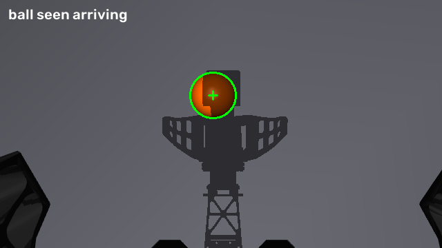

# Wrist camera, 2026-11-25

Finding the ball with the camera on the arm's wrist, so that its position no longer has to be read by resting the gripper tip on the spot, and turning the arm to face it so that it can be picked up from anywhere around the arm.

**Verdict: works in simulation; not yet tried on the real arm.** Everything below was measured in MuJoCo or on saved pictures. On the real arm only reads have run: the servos' status, the limp arm's pose, and single pictures through the camera watcher (`look`). No motor was powered for this work. The camera has not been calibrated on the real arm, the detector has not seen a real picture of the ball in front of the gripper, and no real pickup has used the camera. [What is left](#what-is-left-on-the-real-arm) lists the steps, which need the author at the arm.



*The simulated wrist camera at the start pose, half the real picture's size. The dark shape is the arm's own shadow, which also covers most of the ball, as in the real camera's pictures. The green circle is what the detector found.*

## What was built

| Part | Where | Tested on |
| --- | --- | --- |
| Ball detector | `understudy/vision.py` | Four real pictures from this camera (none with a ball in front of the gripper) with a painted ball added; rendered MuJoCo pictures |
| Camera geometry | `understudy/camera_model.py` | Unit tests |
| Calibration fit | `understudy/camera_calibration.py` | Simulated sightings with noise and a distorting lens; rendered MuJoCo pictures |
| Calibration procedure | `understudy/camera_collect.py`, `real_arm.py camera-collect`, `camera-fit` | A stand-in arm with painted pictures; the simulated arm with rendered pictures |
| Ball source for the pickup | `understudy.runner.CameraBall` | Unit tests; MuJoCo, table below |
| Finding and facing the ball | `understudy/seek.py`, `real_arm.py run --camera` | A stand-in arm; the real-arm tool run against the simulated arm |
| Pictures from the real camera | `understudy/camera_feed.py`, `scripts/camera_watch.sh` | The watcher route: on the real camera, through `look`. The live stream: against a stand-in program only, **never against the real camera** |

## Pickup in MuJoCo with the wrist camera

200 attempts per row, policy [2026-11-24-claw](../../pickup/2026-11-24-claw/README.md), vendor arm model, 50 ms servo profile, 15 ms command delay. The wrist camera is rendered at 640 × 360 and the ball is found in each picture by the same detector the real arm uses, except in the row marked geometry. "Lifted at the end" means the ball's centre is more than 5 cm above the desk over the final half second.

"Speed limits" are the ones used on the real arm: joint targets move at most 0.3 rad/s and sit at most 0.05 rad from the joint, 15 s attempts. Without them the policy's fastest joint peaks at a median 5.5 to 5.8 rad/s across these rows, the speed that hit the desk on the real arm; with them, 0.42 to 0.45 rad/s.

"Faced" means the arm looked for the ball, turned "straight ahead" to put it 3 cm to the left, and swivelled there before the pickup. "Anywhere around" puts the ball anywhere the arm can turn to face (up to 57 degrees either way) at 15 to 24 cm from the swivel axis; "trained patch" is the 6 × 12 cm area in front of the arm the policy was trained on.

| File | Speed limits | Ball placed | Faced | Ball position from | Camera taken to be out by | Ball found | Lifted at the end |
| --- | --- | --- | --- | --- | --- | --- | --- |
| `mujoco-gentle-tracked-not-faced.json` | yes | trained patch | no | camera, every step | nothing | 100% | 61.5% |
| `mujoco-gentle-tracked-faced.json` | yes | trained patch | yes | camera, every step | nothing | 100% | 91.5% |
| `mujoco-gentle-one-look-faced.json` | yes | trained patch | yes | one look before the pickup | nothing | 100% | 91.0% |
| `mujoco-gentle-around-tracked.json` | yes | anywhere around | yes | camera, every step | nothing | 100% | **99.0%** |
| `mujoco-gentle-around-tracked-camera-3mm.json` | yes | anywhere around | yes | camera, every step | 3 mm, 1° | 98.5% | 95.5% |
| `mujoco-gentle-around-tracked-camera-6mm.json` | yes | anywhere around | yes | camera, every step | 6 mm, 2° | 98.0% | 90.5% |
| `mujoco-gentle-around-one-look-camera-3mm.json` | yes | anywhere around | yes | one look before the pickup | 3 mm, 1° | 98.5% | 95.5% |
| `mujoco-gentle-around-geometric.json` | yes | anywhere around | yes | geometry, no rendering, fingers ignored | nothing | 99.5% | 98.5% |
| `mujoco-fast-tracked.json` | no | trained patch | no | camera, every step | nothing | 100% | 99.0% |
| `mujoco-fast-one-look.json` | no | trained patch | no | one look before the pickup | nothing | 100% | 99.0% |
| `mujoco-fast-tracked-camera-3mm.json` | no | trained patch | no | camera, every step | 3 mm, 1° | 100% | 99.5% |
| `mujoco-fast-tracked-camera-6mm.json` | no | trained patch | no | camera, every step | 6 mm, 2° | 100% | 98.5% |
| `mujoco-fast-around-far-only-tracked.json` | no | around, 18.5 to 24.5 cm only | yes | camera, every step | nothing | 100% | 100% |
| `mujoco-fast-around-tracked.json` | no | anywhere around | yes | camera, every step | nothing | 100% | 69.5% |

What the table says:

- **The camera does as well as knowing the ball's position.** Without limits it lifts 99.0%, against 99.5% with the position typed in ([earlier table](../../pickup/2026-11-24-claw/README.md)).
- **Turning to face the ball is what makes the speed-limited policy usable.** With the limits it lifted 61.5% and failed for nearly every ball to the right. Faced, it lifts 91.5% in the same patch, and 99.0% anywhere around the arm at 15 to 24 cm. The patch does worse than "anywhere" because its far corners are more than 24 cm away.
- **One look is as good as following the ball**, in simulation, where nothing moves the ball before the gripper reaches it. That matters because one look works over a remote login and following does not (see the main README).
- **A camera that is a little out costs a little.** 3 mm and 1° costs 3.5 points; 6 mm and 2° costs 8.5.
- **The ball is out of sight for part of every attempt and that is handled.** With the limits the camera places the ball on a median 86 to 88% of the steps before the gripper closes, and without them on 36%, because the arm moves faster than the ball stays in the picture. On the rest the last position seen is kept. In "anywhere around", most balls are not in the picture at all from the start pose until the arm swivels to look.
- **Without the speed limits, balls nearer than about 18 cm fail** (last two rows). The near part of the range below holds only with the limits on. The real arm is only run with them.
- **Placement is unchanged**: the ball is held 35 to 39 mm from the requested point, as before. "At target" (within 3 cm) stays under 15% in every row and is in the files.

### How far away the ball can be

40 attempts per centimetre, speed limits on, faced, camera every step (`mujoco-distance-NNcm.json`, the ball NN to NN+1 cm from the swivel axis, anywhere the arm can turn to face).

| Distance from the swivel axis, cm | 14 | 15 | 16 | 17 | 18 | 19 | 20 | 21 | 22 | 23 | 24 | 25 | 26 | 27 | 28 |
| --- | --- | --- | --- | --- | --- | --- | --- | --- | --- | --- | --- | --- | --- | --- | --- |
| Lifted at the end, % | 52.5 | 100 | 100 | 100 | 97.5 | 97.5 | 100 | 100 | 100 | 92.5 | 77.5 | 40 | 0 | 0 | 0 |

`real_arm.py run --camera` therefore stops before the pickup unless the ball is 15 to 24 cm from the swivel axis (`understudy.runner.REACH_BAND_M`), and says how far it is. The swivel axis is 1.1 cm behind the arm model's origin. A first guess at this range, taken from the trained patch, was 18.5 to 24.5 cm; the measurement moved it.

## The calibration procedure in MuJoCo

`scripts/mujoco_camera_calibration.py` runs the real procedure on the simulated arm: a ball is put down, the arm notices it in its pictures, learns its colour, looks from eleven small moves and twelve wider views it chooses, and the camera is fitted. The procedure is not told where the camera is mounted. The fitted camera is then checked on 100 balls in places it never saw, each looked at once from the start pose.

| File | Ball looked at in | Arm's joint zeros out by up to | Sightings | Fit's own error on the desk, typical | Camera position found to | New balls: typical error | New balls: worst |
| --- | --- | --- | --- | --- | --- | --- | --- |
| `mujoco-calibration-two-places.json` | 2 places | nothing | 46 | 0.12 mm | 0.8 mm | 0.15 mm | 0.24 mm |
| `mujoco-calibration-one-place.json` | 1 place | nothing | 23 | 0.15 mm | 0.9 mm | 0.15 mm | 0.24 mm |
| `mujoco-calibration-arm-half-degree-out.json` | 2 places | 6 ticks (0.5°) | 46 | 0.20 mm | 2.7 mm | 2.2 mm | 3.0 mm |
| `mujoco-calibration-arm-one-degree-out.json` | 2 places | 11 ticks (1°) | 46 | 0.32 mm | 4.5 mm | 3.9 mm | 5.6 mm |

- In all four runs the arm never touched the desk, all 100 new balls were seen, and no ball was reported moved.
- The camera can only be as right as the arm. With the arm's own zero points half a degree out, the fit still agrees with itself to 0.2 mm, but puts balls 2 mm from where they are. The fit's own error does not show this, so a small number from `camera-fit` on the real arm is necessary and not sufficient. The real arm's touch calibration left a typical 3.6 mm at the gripper tip, so a few millimetres should be expected, which is the "3 mm, 1°" row above.
- These pictures are clean renders. The real camera is hazy and its lens bends lines; the fit has a term for that, exercised only on simulated sightings.

## What has run on the real arm

Reads only. No motor was powered.

- `status` and `where`: the six servos answer, torque off, no errors.
- Two pictures of the desk through the camera watcher, with the arm limp and the gripper resting on the desk, the second through the new `look` command. `look` reported two orange patches, neither whole, and correctly said the camera is not calibrated.
- That checks the picture-taking route. It does not check the detector's judgement of the ball: no ball was in front of the gripper. Something orange lies under the closed gripper in these pictures, partly hidden by the fingers. Whether that is the ball is not known.
- The detector's tests use four pictures from this camera: these two kinds, and two taken earlier the same day from the start pose.

## A hazard found and fixed before any powered run

The calibration procedure works out a rough camera and chooses views between poses, about half a second of arithmetic each, during which the first version said nothing to the servos. Their watchdog cuts power after 500 ms of silence, and the arm would have dropped from the raised pose, as it did on 2026-11-25 for the same reason in another command. The simulated arm has no watchdog, so no test caught it; it was found by reading the code.

- First fix, doing the arithmetic on a second thread while the first kept reading the arm: measured, and it does not work. The reading thread was held up for 471 ms of a 470 ms fit.
- Fix in place: the fit and the choice of views themselves read the arm every 50 ms as they work (`understudy.camera_collect.Pulse`).
- The simulated arm used to test the tool now records its longest silence while powered, and the tests require it to stay under 250 ms. With the fix switched off it reaches 0.59 s. With it on, 0.06 s across a whole calibration and a pickup.
- Finding the ball in a full-size picture takes 55 ms on the development machine. That was not timed on the laptop the arm is plugged into.

## What is left, on the real arm

Each step needs the author's go-ahead when it powers the motors. On the laptop the arm is plugged into, the branch is in its own folder, `~/understudy-camera-work`, beside the existing `~/understudy`, whose calibration it uses. The camera watcher must be running in that laptop's Terminal (`~/understudy-camera/camera-watch.sh`).

```sh
cd ~/understudy-camera-work
PY=~/understudy/.venv/bin/python
ARM="--port /dev/cu.usbmodem101 --calibration $HOME/understudy/calibration.local.json --camera_file $HOME/understudy/camera.local.json --sightings $HOME/understudy/sightings.local.json"
```

1. **Calibrate the camera** (powered; about four minutes by the count of poses, not yet timed). Take the ball off the desk in front of the arm, then:

   ```sh
   $PY scripts/real_arm.py $ARM camera-collect
   ```

   The arm rises to the start pose and holds still. **Put the ball on the desk in front of the gripper.** The arm sees it, waits three seconds, and looks at it from about twenty poses, slowly (no joint faster than 14 degrees a second, gripper tip never nearer the desk than 7 cm), then returns and holds still. **Move the ball to another spot in front of the gripper.** It does the same again, lowers itself and switches off. If the ball is not put down within about a minute it says so, lowers and switches off; if it is not moved the second time it carries on with one place.

2. **Work out the camera** (no power):

   ```sh
   $PY scripts/real_arm.py $ARM camera-fit
   ```

   It prints where the ball was each time, how far the sightings of each place disagree, and where the camera sits on the gripper, and saves the camera unless the typical disagreement is over 8 mm. Expect a few millimetres.

3. **Find the ball without picking it up** (powered, slow moves only). Put the ball anywhere in front of the arm, 15 to 24 cm from the swivel axis:

   ```sh
   $PY scripts/real_arm.py $ARM run --policy results/pickup/2026-11-24-claw/policy.onnx --camera look --find_only \
       --max_speed 0.3 --max_lead 0.05 --seconds 15 --log ~/understudy/find-1.local.json
   ```

   The arm rises, looks (swivelling left and right if the ball is not ahead of it), turns to face the ball, says how far it is from the swivel axis and how far round, and lowers itself. A ruler from the swivel axis to the ball's centre says whether to believe it. This is the first time the calibrated camera places a real ball.

4. **Pick the ball up** (powered). The same command without `--find_only`, and `--log ~/understudy/run-camera-1.local.json`. After facing the ball the arm runs the policy with the speed limits. It stops before the pickup and lowers itself if it does not see the ball or the ball is too near or too far.

Following the ball during the pickup (`--camera live`) is the step after that. It must be started from the laptop's own Terminal, and its camera stream has not been tried on the real camera.

## What is not known

- **How the real ball looks to this camera.** The colour test is learnt from the ball when it is first put down, so no colour is assumed, but that has only run on painted and rendered balls.
- **How good the real calibration will be.** In simulation it is as good as the arm's own calibration allows.
- **Whether the real arm picks up as often as the simulated one with the limits on.** One real pickup has been made with them, at one position, without the camera.
- **Whether turning to face the ball is as neutral on the real arm as in simulation.** It assumes the arm behaves the same whichever way the swivel points: a level desk, and cables that do not pull.
- **The delay of the live camera stream.** Three control steps (100 ms) is assumed for `--camera live`.

## How to reproduce

```sh
pip install -r requirements-dev.txt
P="python scripts/mujoco_pickup.py --policy results/pickup/2026-11-24-claw/policy.onnx --attempts 200"
G="--max_speed 0.3 --max_lead 0.05 --seconds 15"
$P $G --ball_source wrist-camera                                    # mujoco-gentle-tracked-not-faced
$P $G --ball_source wrist-camera --face                             # mujoco-gentle-tracked-faced
$P $G --ball_source wrist-look --face                               # mujoco-gentle-one-look-faced
$P $G --ball_source wrist-camera --face --area around               # mujoco-gentle-around-tracked
$P $G --ball_source wrist-camera --face --area around --camera_mount_error_mm 3 --camera_angle_error_deg 1
$P $G --ball_source wrist-camera --face --area around --geometric_camera
$P --ball_source wrist-camera --face --area around --distance 0.185 0.245   # mujoco-fast-around-far-only-tracked
python scripts/mujoco_pickup.py --policy results/pickup/2026-11-24-claw/policy.onnx --attempts 40 $G \
    --ball_source wrist-camera --face --area around --distance 0.20 0.21    # mujoco-distance-20cm
python scripts/mujoco_camera_calibration.py --places 2 --zero_error_ticks 6  # mujoco-calibration-arm-half-degree-out
```

The seed is fixed. `mujoco-gentle-tracked-not-faced.json` was run twice and gave the same figures both times. Rendering needs OpenGL; `--geometric_camera` does without it.

## Files

| File | Purpose | How to use |
| --- | --- | --- |
| `mujoco-gentle-*.json`, `mujoco-fast-*.json` | The fourteen pickup measurements in the first table | Read as JSON |
| `mujoco-distance-NNcm.json` | The fifteen measurements by distance | Read as JSON |
| `mujoco-calibration-*.json` | The four runs of the calibration procedure | Read as JSON |
| `mujoco-ball-arriving.png` | The simulated wrist camera's picture when the ball was first seen | Any image viewer |

The policy itself is in [../../pickup/2026-11-24-claw](../../pickup/2026-11-24-claw/README.md). The real pictures the detector is tested on are in `tests/fixtures/camera/`.
