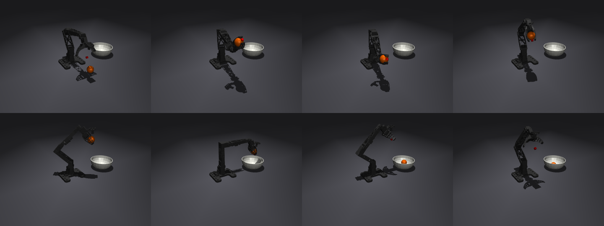

# Carrying the ball to a bowl, 2026-11-26

After the pickup, the arm carries the ball to a bowl standing at its side and drops it in. The move (`understudy/carry.py`) is fixed and slow, not learnt, and is the same whoever picked the ball up.

**Verdict: works in simulation; not tried on the real arm.** Everything here was measured in MuJoCo. No motor was powered and nothing was read from the real arm for this work. The bowl is a simulated one made to the description of a cereal bowl (about 15 cm across the opening, rim 6 to 7 cm up, curved inside, ceramic); no real bowl has been measured.



*One simulated attempt, seen from outside (the wrist camera is not used here). Top row: the pickup. Bottom row: raised and swivelled to the bowl, out over it, lowered and let go, and back. [The clip](mujoco-pickup-and-carry-to-bowl.mp4) runs at the real speed, a little over a minute.*

## The move

1. Raise the ball to a compact carrying pose (the search's look pose), gripper closed.
2. Swivel to the bowl.
3. Move out until the ball is over the bowl's middle, its underside 6 cm above the rim.
4. Lower straight down until the ball's underside is 1 cm above the rim. The finger tips are then 1.8 cm above the rim; they never go below it.
5. Open the gripper over 1.4 s and wait 0.6 s. The ball falls the last few centimetres.
6. Rise straight up again, return to the carrying pose and swivel back to face ahead, gripper open.

No joint is asked to turn faster than 0.25 rad/s (14 degrees a second); the simulated servos peaked at 0.26. A carry takes 56 s at the median and 62 s at the longest, after the 15 s pickup. While it swivels the ball moves at up to 3.2 cm a second.

Checks: the carry does not start unless the fingers say something is held and it has been lifted; it stops at once, the arm left raised where it is, if the fingers close fully (the ball was lost); a bowl out of reach, further round than the swivel goes, or with its near edge under 10 cm from the swivel axis is refused before anything moves. In all of the carries below, 6,143 of them, the ball was never lost on the way.

## The pickup swings to its right, so the bowl goes on the left

Standing a bowl beside the arm showed something the earlier measurements had missed. To take the ball the arm turns up to 11 degrees to the left of where it faces. Then, lifting, it swings **up to 42 degrees to the right** with the gripper still under 11 cm, rolls its wrist, and comes back to hold the ball 10 to 16 cm up. In the first trial with a bowl on the right, the wrist, the fingers and the ball itself struck it. This is the trained policy's own habit at the real arm's speed limits, measured in every run here (furthest right 41.9 degrees, furthest left 10.9, furthest beyond the ball 4.1 cm, over 6,250 pickups). The one pickup on the real arm also drifted 11 cm to the right and rolled its wrist 90 degrees, which was put down at the time to the tool not recognising the hold.

So a pickup is refused (`understudy.carry.in_the_way`) when the bowl's edge is within 9 cm of anywhere the arm goes for that ball: from 45 degrees right of where it faces to 12 degrees left, out to 8 cm beyond the ball. Seven of those centimetres are the gripper's half-width and two are slack for a bowl that is not quite where it was said to be. A ball lying in the bowl is refused too.

What that leaves, for a ball 15 to 24 cm out, as the turns to face the ball that are still allowed (the arm turns at most 57 degrees either way):

| Bowl | Middle 20 cm from the swivel axis | 23 cm | 26 cm |
| --- | --- | --- | --- |
| 15 cm across, directly at the arm's left (90 degrees round) | 57 right to 22 left | 57 right to 32 left | 57 right to 38 left |
| 15 cm, 75 degrees round to the left | 57 right to 7 left | 57 right to 17 left | 57 right to 23 left |
| 15 cm, directly at the arm's right | 11 left to 57 left | 1 left to 57 left | 5 right to 57 left |
| 12 cm, directly at the left | 57 right to 29 left | 57 right to 37 left | 57 right to 42 left |
| 18 cm, directly at the left | 57 right to 13 left | 57 right to 26 left | 57 right to 34 left |

A bowl on the right costs about half the sector; the same bowl on the left costs about a fifth of it. The swivel reaches 90 degrees and no further, so directly at the left is as far round as the bowl can go.

## Which bowl, and where

**Bowl:** an ordinary cereal bowl is right. Inside width at the rim 12 to 16 cm, rim 5 to 9 cm above the desk, heavy enough not to slide (ceramic or stoneware, 300 g or more), and not orange, red, pink or yellow, so that nothing about it looks like the ball to the camera. Nothing measured here argues for a particular size within that range: every ball lifted ended in the bowl for openings of 8, 10, 12, 15 and 18 cm and rims of 3, 5, 6.5, 9 and 10 cm. A narrower bowl leaves a little more of the sector free and a wider one forgives a larger mistake about where it stands.

**Place:** directly at the arm's left, its middle 24 to 28 cm from the swivel axis, on the same desk the ball is on. Further out frees more of the sector; the arm can reach a bowl's middle up to 32 cm out, and 26 to 30 cm was measured, but a real arm sags when stretched and that is not in these numbers.

**Telling the arm where it is:** two readings of `where`, with the arm limp. Hold the gripper's tip over the middle of the bowl (the height does not matter) and read x and y; rest the tip on the rim and read x, y and z. The rim reading gives the rim's height and, with the first, the opening's width. Two are enough. Letting go above the rim, as the tool does, and with the bowl within 2 cm of where the carry was told, all 4,378 of 4,378 balls ended in it and the arm touched it in 0 of those carries and 0 of 4,450 pickups; at 3 cm out, all 782 of 782 balls still ended in it and the arm touched it in 2 carries and 2 of 800 pickups, pushing it 0.4 mm at most. A rim 2 cm higher than the arm was told made no difference, because the fingers are over the bowl's middle and not its rim. Balls begin to miss when the ball is let go over the rim itself: an 8 cm bowl 4 cm out of place caught half of them, and a 15 cm bowl 7 cm out caught 95%.

```sh
python scripts/real_arm.py run --policy results/pickup/2026-11-24-claw/policy.onnx --camera look \
    --bowl MIDDLE_X MIDDLE_Y RIM_X RIM_Y RIM_Z --max_speed 0.3 --max_lead 0.05 --seconds 15   # POWERED
```

## Measurements

MuJoCo, vendor arm model, policy [2026-11-24-claw](../../pickup/2026-11-24-claw/README.md) told where the ball is, the real arm's speed limits (0.3 rad/s, 0.05 rad lead, 15 s), the arm turned to face each ball. Balls anywhere the arm can face, 15 to 24 cm out. Unless a row says otherwise the bowl stands anywhere from 30 to 90 degrees round on either side, as close as the rule allows out to 26 cm, wherever it is not in the way of that ball. The bowl is a free body of 400 g: the ball and the arm can hit it, and it moves if pushed. "In the bowl" means the ball's middle is below the rim and inside the bowl; it is scored when the gripper has opened and again a second later, and once more at the end.

How a foam ball lands on ceramic is not known, so most rows use a ball that comes back up half the height it fell (measured in the simulator: 52% of a 5 cm drop), which is livelier than a foam ball is likely to be.

**A bowl 15 cm across with its rim 6.5 cm up, and how the ball lands in it**

| Ball | Balls lifted | In the bowl, and still a second later | In the bowl at the end | Arm touched the bowl | Held ball touched the bowl | Bowl pushed at most | Ball lost on the way | File |
| --- | --- | --- | --- | --- | --- | --- | --- | --- |
| does not bounce | 198 of 200 | 100% | 100% | 0% | 0% | 0 mm | 0% | `bowl-15cm-rim-6.5cm.json` |
| comes back up a fifth of its fall | 198 of 200 | 100% | 100% | 0% | 0% | 0 mm | 0% | `bowl-15cm-rim-6.5cm-bounce-a-fifth.json` |
| comes back up half its fall | 198 of 200 | 100% | 100% | 0% | 0% | 0 mm | 0% | `bowl-15cm-rim-6.5cm-bounce-a-half.json` |
| half its fall; bowl at the arm's left, 85 to 90 degrees round, 23 to 26 cm out | 197 of 200 | 100% | 100% | 0% | 0% | 0 mm | 0% | `bowl-at-the-left-23-to-26cm-bounce-a-half.json` |
| the same, the bowl 3 cm from where told | 147 of 150 | 100% | 100% | 0% | 0% | 0 mm | 0% | `bowl-at-the-left-23-to-26cm-off-by-3cm-bounce-a-half.json` |
| half its fall; bowl at the arm's left, 26 to 30 cm out | 146 of 150 | 100% | 100% | 0% | 0% | 0 mm | 0% | `bowl-at-the-left-26-to-30cm-bounce-a-half.json` |
| the same, the bowl 3 cm from where told | 146 of 150 | 100% | 100% | 0% | 0% | 0 mm | 0% | `bowl-at-the-left-26-to-30cm-off-by-3cm-bounce-a-half.json` |

**Opening width, and how far the bowl stands from where the carry was told (rim 6.5 cm, ball bounces half its fall)**

| Opening, bowl off by | Balls lifted | In the bowl, and still a second later | In the bowl at the end | Arm touched the bowl | Held ball touched the bowl | Bowl pushed at most | Ball lost on the way | File |
| --- | --- | --- | --- | --- | --- | --- | --- | --- |
| 18 cm, where told | 96 of 100 | 100% | 100% | 0% | 0% | 0 mm | 0% | `bowl-18cm-off-by-0cm-bounce-a-half.json` |
| 18 cm, 1 cm | 96 of 100 | 100% | 100% | 0% | 0% | 0 mm | 0% | `bowl-18cm-off-by-1cm-bounce-a-half.json` |
| 18 cm, 2 cm | 96 of 100 | 100% | 100% | 0% | 0% | 0 mm | 0% | `bowl-18cm-off-by-2cm-bounce-a-half.json` |
| 18 cm, 3 cm | 96 of 100 | 100% | 100% | 0% | 0% | 0 mm | 0% | `bowl-18cm-off-by-3cm-bounce-a-half.json` |
| 15 cm, where told | 198 of 200 | 100% | 100% | 0% | 0% | 0 mm | 0% | `bowl-15cm-rim-6.5cm-bounce-a-half.json` |
| 15 cm, 1 cm | 98 of 100 | 100% | 100% | 0% | 0% | 0 mm | 0% | `bowl-15cm-off-by-1cm-bounce-a-half.json` |
| 15 cm, 2 cm | 98 of 100 | 100% | 100% | 0% | 0% | 0 mm | 0% | `bowl-15cm-off-by-2cm-bounce-a-half.json` |
| 15 cm, 3 cm | 98 of 100 | 100% | 100% | 1% | 0% | 0.4 mm | 0% | `bowl-15cm-off-by-3cm-bounce-a-half.json` |
| 15 cm, 4 cm | 98 of 100 | 100% | 100% | 2% | 0% | 4.4 mm | 0% | `bowl-15cm-off-by-4cm-bounce-a-half.json` |
| 15 cm, 5 cm | 98 of 100 | 100% | 100% | 3.1% | 0% | 4.2 mm | 0% | `bowl-15cm-off-by-5cm-bounce-a-half.json` |
| 15 cm, 6 cm | 98 of 100 | 100% | 100% | 2% | 0% | 3.6 mm | 0% | `bowl-15cm-off-by-6cm-bounce-a-half.json` |
| 15 cm, 7 cm | 98 of 100 | 94.9% | 94.9% | 3.1% | 0% | 2.8 mm | 0% | `bowl-15cm-off-by-7cm-bounce-a-half.json` |
| 12 cm, where told | 98 of 100 | 100% | 100% | 0% | 0% | 0 mm | 0% | `bowl-12cm-off-by-0cm-bounce-a-half.json` |
| 12 cm, 1 cm | 98 of 100 | 100% | 100% | 0% | 0% | 0 mm | 0% | `bowl-12cm-off-by-1cm-bounce-a-half.json` |
| 12 cm, 2 cm | 98 of 100 | 100% | 100% | 0% | 0% | 0 mm | 0% | `bowl-12cm-off-by-2cm-bounce-a-half.json` |
| 12 cm, 3 cm | 98 of 100 | 100% | 100% | 1% | 0% | 0.3 mm | 0% | `bowl-12cm-off-by-3cm-bounce-a-half.json` |
| 12 cm, 4 cm | 98 of 100 | 100% | 100% | 1% | 0% | 1.7 mm | 0% | `bowl-12cm-off-by-4cm-bounce-a-half.json` |
| 12 cm, 5 cm | 98 of 100 | 100% | 100% | 2% | 0% | 0.3 mm | 0% | `bowl-12cm-off-by-5cm-bounce-a-half.json` |
| 10 cm, where told | 98 of 100 | 100% | 100% | 0% | 0% | 0 mm | 0% | `bowl-10cm-off-by-0cm-bounce-a-half.json` |
| 10 cm, 1 cm | 98 of 100 | 100% | 100% | 0% | 0% | 0 mm | 0% | `bowl-10cm-off-by-1cm-bounce-a-half.json` |
| 10 cm, 2 cm | 98 of 100 | 100% | 100% | 0% | 0% | 0 mm | 0% | `bowl-10cm-off-by-2cm-bounce-a-half.json` |
| 10 cm, 3 cm | 98 of 100 | 100% | 100% | 0% | 0% | 0 mm | 0% | `bowl-10cm-off-by-3cm-bounce-a-half.json` |
| 8 cm, where told | 99 of 100 | 100% | 100% | 0% | 0% | 0 mm | 0% | `bowl-8cm-off-by-0cm-bounce-a-half.json` |
| 8 cm, 1 cm | 99 of 100 | 100% | 100% | 0% | 0% | 0 mm | 0% | `bowl-8cm-off-by-1cm-bounce-a-half.json` |
| 8 cm, 2 cm | 99 of 100 | 100% | 100% | 0% | 0% | 0 mm | 0% | `bowl-8cm-off-by-2cm-bounce-a-half.json` |
| 8 cm, 3 cm | 99 of 100 | 100% | 100% | 0% | 0% | 0.1 mm | 0% | `bowl-8cm-off-by-3cm-bounce-a-half.json` |
| 8 cm, 4 cm | 99 of 100 | 49.5% | 49.5% | 1% | 0% | 0.2 mm | 0% | `bowl-8cm-off-by-4cm-bounce-a-half.json` |

**Rim height (opening 15 cm, ball bounces half its fall)**

| Rim | Balls lifted | In the bowl, and still a second later | In the bowl at the end | Arm touched the bowl | Held ball touched the bowl | Bowl pushed at most | Ball lost on the way | File |
| --- | --- | --- | --- | --- | --- | --- | --- | --- |
| 3 cm | 148 of 150 | 100% | 100% | 0% | 0% | 0 mm | 0% | `bowl-15cm-rim-3cm-bounce-a-half.json` |
| 5 cm | 148 of 150 | 100% | 100% | 0% | 0% | 0 mm | 0% | `bowl-15cm-rim-5cm-bounce-a-half.json` |
| 6.5 cm | 198 of 200 | 100% | 100% | 0% | 0% | 0 mm | 0% | `bowl-15cm-rim-6.5cm-bounce-a-half.json` |
| 9 cm | 148 of 150 | 100% | 100% | 0% | 0% | 0 mm | 0% | `bowl-15cm-rim-9cm-bounce-a-half.json` |
| 10 cm | 148 of 150 | 100% | 100% | 0% | 0% | 0 mm | 0% | `bowl-15cm-rim-10cm-bounce-a-half.json` |
| 6.5 cm, told 5.5 cm | 148 of 150 | 100% | 100% | 0% | 0% | 0 mm | 0% | `bowl-rim-1cm-higher-than-told-bounce-a-half.json` |
| 6.5 cm, told 4.5 cm | 148 of 150 | 100% | 100% | 0% | 0% | 0 mm | 0% | `bowl-rim-2cm-higher-than-told-bounce-a-half.json` |

**Height of the ball's underside above the rim when it is let go (bowl 15 cm, rim 6.5 cm, ball bounces half its fall)**

| Let go | Balls lifted | In the bowl, and still a second later | In the bowl at the end | Arm touched the bowl | Held ball touched the bowl | Bowl pushed at most | Ball lost on the way | File |
| --- | --- | --- | --- | --- | --- | --- | --- | --- |
| -2 cm, bowl where told | 148 of 150 | 100% | 100% | 0% | 0% | 0 mm | 0% | `let-go--2cm-above-rim-bounce-a-half.json` |
| -2 cm, bowl 2 cm off | 148 of 150 | 100% | 100% | 48.6% | 0% | 4.5 mm | 0% | `let-go--2cm-above-rim-off-by-2cm-bounce-a-half.json` |
| +0 cm, bowl where told | 148 of 150 | 100% | 100% | 0% | 0% | 0 mm | 0% | `let-go-0cm-above-rim-bounce-a-half.json` |
| +0 cm, bowl 2 cm off | 148 of 150 | 100% | 100% | 0% | 0% | 0 mm | 0% | `let-go-0cm-above-rim-off-by-2cm-bounce-a-half.json` |
| +1 cm, bowl where told | 198 of 200 | 100% | 100% | 0% | 0% | 0 mm | 0% | `bowl-15cm-rim-6.5cm-bounce-a-half.json` |
| +1 cm, bowl 2 cm off | 98 of 100 | 100% | 100% | 0% | 0% | 0 mm | 0% | `bowl-15cm-off-by-2cm-bounce-a-half.json` |
| +3 cm, bowl where told | 148 of 150 | 100% | 100% | 0% | 0% | 0 mm | 0% | `let-go-3cm-above-rim-bounce-a-half.json` |
| +3 cm, bowl 2 cm off | 148 of 150 | 100% | 100% | 0% | 0% | 0 mm | 0% | `let-go-3cm-above-rim-off-by-2cm-bounce-a-half.json` |
| +5 cm, bowl where told | 148 of 150 | 100% | 100% | 0% | 0% | 0 mm | 0% | `let-go-5cm-above-rim-bounce-a-half.json` |
| +5 cm, bowl 2 cm off | 148 of 150 | 100% | 100% | 0% | 0% | 0 mm | 0% | `let-go-5cm-above-rim-off-by-2cm-bounce-a-half.json` |

**Carry speed (fastest any joint is asked to turn)**

| Speed | Balls lifted | In the bowl, and still a second later | In the bowl at the end | Arm touched the bowl | Held ball touched the bowl | Bowl pushed at most | Ball lost on the way | File |
| --- | --- | --- | --- | --- | --- | --- | --- | --- |
| 0.25 rad/s (the default) | 198 of 200 | 100% | 100% | 0% | 0% | 0 mm | 0% | `bowl-15cm-rim-6.5cm-bounce-a-half.json` |
| 0.5 rad/s | 148 of 150 | 100% | 100% | 0% | 0% | 0 mm | 0% | `carry-speed-0.5.json` |
| 1.0 rad/s | 148 of 150 | 100% | 100% | 0% | 0% | 0 mm | 0% | `carry-speed-1.0.json` |

**On the bare desk** (`--bare_desk`, no bowl; the ball given the rolling resistance of a foam ball on a soft surface, 0.03, because the simulated ball otherwise rolls for ever): 194 of 200 balls lifted; carried and let go 100%; at rest within 3 cm of the place 100%; median 7.9 mm, worst 10.9 mm; lost on the way 0%. File: `bare-desk-rolling-resistance-0.03.json`.

## What the carry sweeps

From the arm model's shapes over 38 simulated carries to bowls at the arm's left (80 to 90 degrees round, rims 5 to 9 cm). The camera and its cable are not in the model: add about 5 cm above the wrist.

| While | The arm occupies |
| --- | --- |
| Raising the ball, facing where the pickup left it (up to 20 degrees right or 12 left of the ball's direction) | Up to 30 cm from the swivel axis, 7 cm to each side, from 5 cm above the desk up to 34 cm |
| Swivelling to the bowl with the ball, and back without it | Everything within 16 cm of the swivel axis (8 cm behind), 18 to 34 cm above the desk |
| Over the bowl | Out to 5 cm beyond the bowl's middle, 7 cm to each side, down to 1.8 cm above the rim at the finger tips |

In practice, besides what the pickup needs: nothing taller than 15 cm within 16 cm of the swivel axis between the ball's direction and the bowl, and nothing above the bowl.

## Not tested

- Nothing here has run on the real arm.
- No real bowl: its true shape, weight and how it sits on the desk's surface.
- How a real foam ball bounces on ceramic.
- A real arm's sag when stretched out over the bowl, and the camera and cable on the wrist.
- Whether the real arm swings to the right as far as the simulated one. One real pickup did drift right; it has not been measured.
- The pickup here is told where the ball is. With the camera finding the ball, the refusal uses the camera's answer.

## Reproducing

```sh
pip install -r requirements-dev.txt
python scripts/mujoco_carry.py --policy results/pickup/2026-11-24-claw/policy.onnx --attempts 200 --output out.json
python scripts/mujoco_carry.py --policy results/pickup/2026-11-24-claw/policy.onnx --attempts 1 --seed 3 --bounce 0.15 \
    --side left --bearing_deg 85 90 --distance_cm 23 26 --video clip.mp4     # needs OpenGL
```

Each file's name says what was changed; the options are in `scripts/mujoco_carry.py --help` and each file records its own settings.

## Contents

| File | What it is |
| --- | --- |
| `mujoco-pickup-and-carry-to-bowl.mp4` | One simulated attempt from outside, at the real speed (H.264) |
| `mujoco-pickup-and-carry-to-bowl-frames.png` | Eight frames of it |
| 50 `.json` files | One per row of the tables above, named in the row. Each holds its settings, its summary and a record of every attempt |
