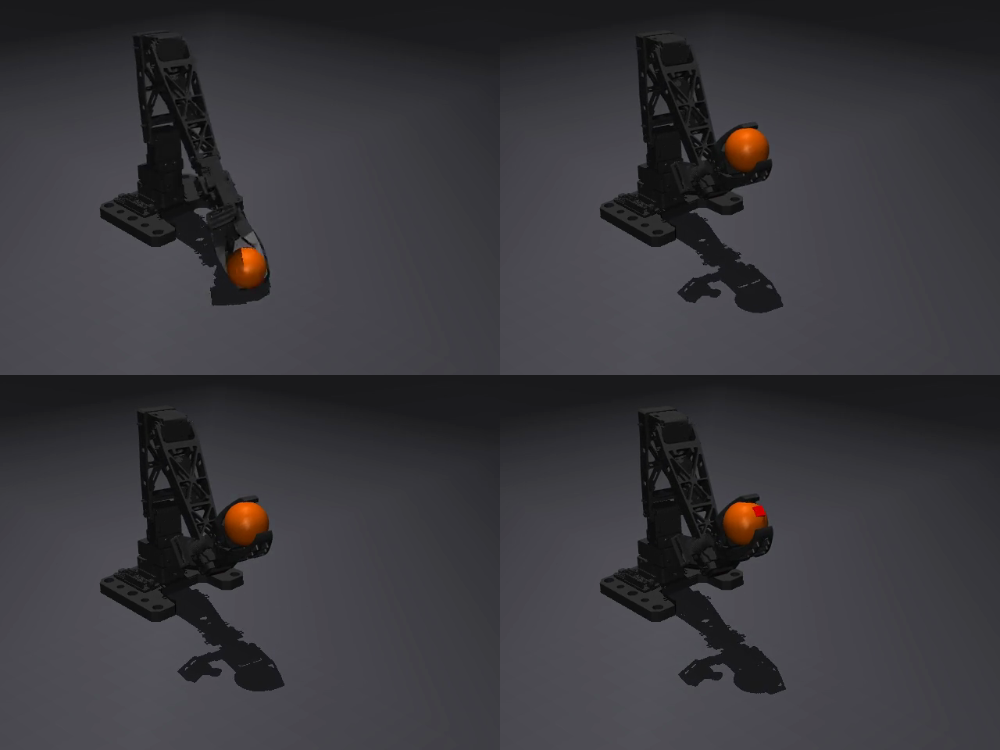

# Ball pickup with claw-shaped fingers, 2026-11-24

The pickup task with the simulated fingers given their real shape and the arm commanded by moving each joint's target. This is the first pickup policy that holds the ball in both simulators.

**Verdict: passes the two-simulator check; not yet tried on a real arm.** In MuJoCo, on the vendor's arm model with camera errors on, the ball is lifted in 100% of 200 attempts and still held at the end in 96%. The [previous policy](../2026-11-24-varied/README.md) managed 3.5%. It holds the ball about 3–4 cm from the requested point, not on it.

**This is the policy after 1,500 of a planned 4,000 training iterations.** The machine training it ran out of rental credit and was stopped a few minutes before the run finished. The final checkpoint and its Isaac Lab measurements are on that machine's disk and are not in this directory. See [What is missing](#what-is-missing).



Video: [mujoco-pickup.mp4](mujoco-pickup.mp4), three attempts in MuJoCo.

## What changed from the previous policy

1. **The fingers collide as the claws they are.** A physics engine collides with the convex hull of a mesh. Each finger is a thin curved claw, and the two close into a hollow; their hulls fill that hollow solid (39.5 cm³ against a real 9.8 cm³), leaving two flat faces that can only pinch a ball at their tips. Each finger is now eight convex pieces that keep the hollow (`scripts/build_finger_collision.py`), in both the Isaac Lab arm and the MuJoCo arm. With this change alone, the previous policy, which had been trained with hull fingers, still held the ball at the end of 66% of MuJoCo attempts instead of 2%.
2. **Joint commands move the target, not the joint.** Each arm joint's target is its previous target plus 0.1 times the policy's output, kept within 0.35 rad of where the joint is. Holding still is then an output of zero whatever the servo stiffness. The earlier "present angle plus an offset" needed a constant output that depended on stiffness, and those policies held the ball 4–5 cm off target. The policy also sees, as five extra inputs, how far each target is ahead of its joint.
3. **Gripper force varies** between simulated arms, from 0.5 to 1.5 times the vendor value.

## How it was produced

- Isaac Lab 3.0.0 with Isaac Sim 6.0.1, PhysX, one NVIDIA L40S, 4,096 simulated arms, seed 47, trained from nothing.
- Checkpoint after 1,500 PPO iterations, about 39 minutes.

```sh
python scripts/build_finger_collision.py   # only if the vendor finger meshes change
$ISAACLAB_PATH/isaaclab.sh -p scripts/check_pickup_scene.py --headless
$ISAACLAB_PATH/isaaclab.sh -p scripts/isaaclab_run.py train --task Understudy-Pickup-Ball-OMX-v0 --headless --max_iterations 4000
$ISAACLAB_PATH/isaaclab.sh -p scripts/evaluate_pickup.py --headless \
    --checkpoint logs/rsl_rl/understudy_pickup_omx/<run>/model_1500.pt --output results/pickup/<name>
python scripts/mujoco_pickup.py --policy results/pickup/<name>/policy.onnx --attempts 200
```

## Results in a second simulator (MuJoCo, vendor arm model)

200 attempts per row, run through `understudy/runner.py` in servo units, with the vendor's 50 ms servo profile and a 15 ms command delay. "Still lifted at the end" means the ball's centre is more than 5 cm above the desk over the final half second. "At target" means it is also within 3 cm of the requested point.

| File | Condition | Lifted at some point | Still lifted at the end | At target | Typical distance from target |
| --- | --- | --- | --- | --- | --- |
| `mujoco-vendor.json` | Vendor settings, camera errors on | 100% | 96.0% | 8.5% | 37 mm |
| `mujoco-camera-exact.json` | Exact camera | 100% | 99.5% | 9.5% | 35 mm |
| `mujoco-stiffness-x0.12.json` | Arm servos at 0.12× vendor stiffness | 90.5% | 73.0% | 52.5% | 26 mm |
| `mujoco-stiffness-x0.3.json` | 0.3× | 98.0% | 86.5% | 28.0% | 33 mm |
| `mujoco-stiffness-x1.5.json` | 1.5× | 98.5% | 89.0% | 6.5% | 37 mm |
| `mujoco-gripper-half-force.json` | Gripper at half force | 94.0% | 88.5% | 47.0% | 29 mm |
| `mujoco-mass-46g.json` | Ball as heavy as a real golf ball (46 g) | 98.0% | 96.5% | 72.5% | 23 mm |
| `mujoco-camera-2cm.json` | Fixed camera error up to 2 cm | 86.5% | 66.5% | 5.5% | 37 mm |
| `mujoco-extra-delay.json` | One more control step (33 ms) of command delay | 79.0% | 53.5% | 8.0% | 36 mm |
| `mujoco-no-camera.json` | No camera; ball assumed where it was placed | 100% | 99.5% | 8.0% | 36 mm |
| `mujoco-hull-fingers.json` | Fingers as convex hulls, as before | 65.5% | 0.5% | 0% | 81 mm |
| `mujoco-gentle-limits.json` | No camera; joint targets limited to 0.6 rad/s and to 0.1 rad from the joint; 10 s attempts | 63.5% | 63.5% | 1.0% | 39 mm |

- The policy is fast. Unlimited, its fastest joint peaks at a median 5.7 rad/s (about 330 degrees a second), the servos' top speed. That is too violent for a first run on a real arm: on 2026-11-25 it hit the desk. The last row limits it from outside, which brings the peak down to a median 0.85 rad/s and the lift rate down to 63.5%, because the policy was not trained to move that slowly. Running it in slow motion instead did worse (13–38% across 2× to 12×). A policy that is gentle and reliable needs the speed limit in its training.
- With the limits, where the ball is decides the outcome. Balls lifted at the end out of 20, at 0.3 rad/s and 0.05 rad, by position in the arm model's frame (cm forward; cm to the left, negative for right):

  | Forward | −9 | −6 | −3 | 0 | 3 | 6 | 9 |
  | --- | --- | --- | --- | --- | --- | --- | --- |
  | 18 | 0 | 0 | 20 | 20 | 20 | 20 | 0 |
  | 20 | 0 | 0 | 3 | 20 | 20 | 20 | 0 |
  | 22 | 0 | 0 | 0 | 20 | 20 | 20 | 9 |
  | 24 | 0 | 0 | 0 | 4 | 17 | 13 | 0 |

  Looser limits (0.6 rad/s with 0.1 rad, 1.0 rad/s with 0.2 rad) give the same one-sided pattern. Without limits the policy lifts the ball everywhere in the trained area (18–24 cm forward, 6 cm either side). Why the limited policy fails to the right has not been investigated.
- The grasp holds. At the vendor's settings the ball is kept to the end in 96% of attempts, and in 73–89% across a 12-fold range of servo stiffness.
- The last row is the same policy with the old finger shape: it keeps the ball in 1 attempt of 200. The finger geometry is what decides whether the grip holds.
- The no-camera row matters for a first hardware test. With the ball's position typed in instead of tracked, the result is as good as with an exact camera, so a real attempt does not have to wait for a camera.
- Placement is the weak point. The ball is held 3–4 cm from the requested point at the vendor's stiffness, and it sits too high: a heavier ball or a softer arm hangs lower and scores better.
- Extra command delay and a camera more than 1 cm out are the conditions that hurt most.

## Results in the training simulator (Isaac Lab)

One evaluation of this checkpoint was run before the machine stopped: 2,000 attempts with every arm, ball and camera varied as in training. Its output was read from the run's console and the result file itself is on the stopped machine, so there is no JSON for it here.

| Condition | Lifted at the end | Held at target | Typical distance from target |
| --- | --- | --- | --- |
| Everything varied | 80.7% | 66.2% | 19 mm |

No per-condition sweep (servo stiffness, camera error, ball mass) exists for this checkpoint in Isaac Lab. The MuJoCo table above is the only sweep.

Two things stand out against the previous policy's 92.1% lifted and 24.1% held: this one is far more accurate about where it holds the ball, and after 1,500 iterations it was lifting less often. Its training log was still rising when last read (ball reaching the target zone in 82% of attempts at about iteration 1,680).

## What is missing

- **The final checkpoint**, after roughly 3,900 to 4,000 iterations, and whatever measurements had started. They are on the rented machine `understudy-isaac`, which stopped when the account's credit ran out. They can be copied off once the machine can be started again. How long a stopped machine is kept with no credit is not known to the author of this file.
- **An Isaac Lab sweep and video** for this policy.
- **A real-arm run.** Nothing here has touched hardware.

## What a first real-arm attempt would need

1. Calibrate and check the arm: `scripts/real_arm.py status`, `calibrate`, `check`. These only read from the servos.
2. A slow first powered move: `scripts/real_arm.py start-pose`.
3. `scripts/real_arm.py run --policy results/pickup/2026-11-24-claw/policy.onnx --ball X Y --dry-run`, then without `--dry-run`, with the ball on a measured spot.

`understudy/dynamixel.py` and `scripts/real_arm.py` are tested against a simulated arm only. Treat them as untested code driving motors.

Known differences from the real arm that remain: the ball is a rigid sphere and real foam compresses; the simulated finger pieces are solid where the real claws are open lattice; the servo values are the vendor's approximate ones; and the real arm's calibration will be off by some amount this has not been tested against beyond a 1–2 cm ball position error.

## Files

| File | Purpose | How to use |
| --- | --- | --- |
| `mujoco-pickup.mp4`, `mujoco-pickup-frames.png` | The policy in MuJoCo | Any video player or image viewer |
| `policy.onnx`, `policy.onnx.data` | Exported policy, iteration 1,500 | `understudy.runtime.OnnxPolicy`; input `[1, 33]`, output `[1, 6]` |
| `interface.json` | How the arm outputs become joint targets (incremental, scale 0.1, lead limit 0.35 rad) | Read automatically by `OnnxPolicy` |
| `mujoco-*.json` | MuJoCo measurements | Read as JSON |

The training checkpoint, run settings and training curves for this run are on the stopped machine.

## Policy interface

Input, 33 numbers: six joint angles relative to the start pose (five arm joints, then the first gripper finger); the same six joints' velocities; the ball's position in the arm base frame; the hold target position followed by the quaternion `0, 0, 0, 1`; the previous six outputs; and, for each of the five arm joints, its previous target minus its present angle.

Output, six numbers. Each arm joint's new target is its previous target plus 0.1 times the output, kept within 0.35 rad of the joint's present angle and inside the joint limits. The first "previous target" of an attempt is the start pose. The sixth output opens the gripper if it is zero or more and closes it otherwise. Commands are sent at 30 Hz.

`understudy/runtime.py` and `understudy/runner.py` implement this. `tests/test_policy_outside_isaac.py` checks it against `tests/fixtures/pickup_rollout.json`, an attempt recorded in Isaac Lab with this checkpoint: the policy input, output and joint targets match to 1e-5 or better on every step. The recording's final step was taken after Isaac Lab had reset the scene, so its joint targets are marked absent and that step is skipped.
