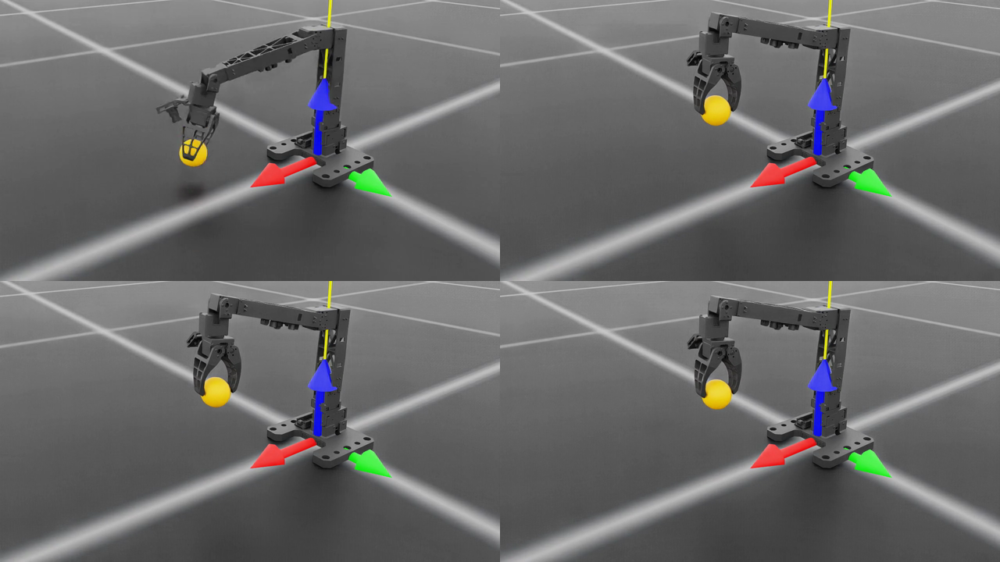

# Ball pickup, first policy, 2026-11-24

The OMX arm picks a foam golf ball off the desk and holds it at a target point. **Simulation only.** It has not been run on a real arm, and the stress tests below say this version should not be expected to work on one yet.



Video: [pickup.mp4](pickup.mp4) (15 seconds, three attempts).

## How it was produced

- Isaac Lab 3.0.0 with Isaac Sim 6.0.1, PhysX, one NVIDIA L40S.
- Task `Understudy-Pickup-Ball-OMX-v0`, 4,096 simulated arms, seed 42.
- Two runs of 1,500 PPO iterations, the second resumed from the first: 1,641 s and 1,657 s.
- Ball: 42.7 mm across, 5 g, friction 1.0. The size is a golf ball's. The mass and friction are assumptions about a foam practice ball and were not measured.

```sh
$ISAACLAB_PATH/isaaclab.sh -p scripts/check_pickup_scene.py --headless
$ISAACLAB_PATH/isaaclab.sh -p scripts/isaaclab_run.py train --task Understudy-Pickup-Ball-OMX-v0 --headless --seed 42
$ISAACLAB_PATH/isaaclab.sh -p scripts/isaaclab_run.py train --task Understudy-Pickup-Ball-OMX-v0 --headless --seed 42 \
    --resume --load_run <first run> --max_iterations 1500
$ISAACLAB_PATH/isaaclab.sh -p scripts/evaluate_pickup.py --headless \
    --checkpoint logs/rsl_rl/understudy_pickup_omx/<second run>/model_2998.pt --output results/pickup/<name>
```

## Results

Each row is 5,000 attempts of five seconds each. An attempt is scored on its final half second:

- **Lifted:** the ball's centre is more than 5 cm above the desk.
- **Held at target:** lifted, and within 3 cm of the target point.

| File | Condition | Lifted | Held at target | Typical distance from target |
| --- | --- | --- | --- | --- |
| `evaluation.json` | As trained | 100% | 88.9% | 17 mm |
| `evaluation-noise.json` | Sensor noise on | 100% | 89.4% | 17 mm |
| `evaluation-friction-0.5.json` | Ball half as grippy | 100% | 90.1% | 17 mm |
| `evaluation-mass-46g.json` | Ball as heavy as a real golf ball (46 g) | 97.9% | 86.4% | 18 mm |
| `evaluation-soft-x0.4.json` | Arm servos 2.5× softer | 91.4% | 6.0% | 47 mm |
| `evaluation-stiff-x6.json` | Arm servos 6× stiffer | 6.0% | 4.4% | 23 mm |
| `evaluation-1500-iterations.json` | As trained, after the first run only | 100% | 23.0% | 44 mm |

## What the numbers mean

- In the conditions it was trained in, the policy picks the ball up essentially every time and holds it within 3 cm of the target about nine times in ten.
- It is not bothered by sensor noise, a slipperier ball or a ball nine times heavier.
- It is very sensitive to how stiff the arm's servos are. With servos six times stiffer it lifts the ball in only 6% of attempts. Six times stiffer is the value in the vendor's own simulation model, and the real value is unknown. **This is the result that matters most for the real arm:** as it stands, this policy would probably fail on hardware.
- The cause is the same as in the [reach baseline](../../reach/2026-11-24-baseline/README.md): the policy has learned to command past where it wants the joints to go, by an amount tuned to one servo stiffness. Reaching survives that error. A fingertip grasp, which needs millimetre placement, does not.

## What has to happen before a real-arm attempt

1. Measure the real servo stiffness with a step-response test, or retrain with stiffness varied across the plausible range so the policy cannot rely on one value.
2. Give the policy the ball's position from a camera. Here it is read from the simulator.
3. Calibrate the arm's encoders against the model, as described in the main README.

## What this does not cover

- No real-arm run.
- The ball is a rigid sphere. Real foam compresses, which changes how a fingertip grasp holds.
- The ball starts in a 6 × 12 cm area in front of the arm, at rest.
- No control delay, encoder quantisation or backlash.

## Files

| File | Purpose | How to use |
| --- | --- | --- |
| `pickup.mp4`, `pickup-frames.png` | Recording of the final policy in simulation | Any video player or image viewer |
| `policy.onnx`, `policy.onnx.data` | Exported policy for running outside Isaac Lab | ONNX Runtime; input `obs` of shape `[1, 28]`, output `actions` of shape `[1, 6]` |
| `policy.pt` | The same policy as TorchScript | `torch.jit.load` |
| `model_2998.pt` | Final training checkpoint | `scripts/evaluate_pickup.py --checkpoint` |
| `params/env.yaml`, `params/agent.yaml` | Exact task and PPO settings of the second run | Read as YAML |
| `training-first-half.tfevents`, `training-second-half.tfevents` | Training curves of the two runs | Put each in its own folder and run `tensorboard --logdir .` |
| `evaluation*.json` | The measurements in the table above | Read as JSON |

## Policy interface

Input, 28 numbers in this order:

1. Six joint angles minus their starting values, radians: the five arm joints, then the first gripper finger. Starting values are `START_POSE` and `GRIPPER_OPEN_RAD` in `understudy/pickup.py`.
2. The same six joints' velocities, radians per second.
3. The ball's position in metres in the arm base frame.
4. The hold target: position in metres in the arm base frame, then the quaternion `0, 0, 0, 1`.
5. The previous six outputs.

Output: six numbers. The first five set the arm: joint position target is `start + 0.5 × output`, clamped to the joint limits. The sixth sets the gripper: open if it is zero or more, closed if it is negative. Commands are sent at 30 Hz.

## How the reward was arrived at

The first training attempt used only Isaac Lab's standard lift rewards. After 300 iterations the arm reliably put its open gripper around the ball and never closed it, because nothing paid for closing. Adding a reward for closing while the ball is between the fingers, and one that rises with every millimetre the ball leaves the desk, produced the first lifts at about iteration 320 of the next run.
