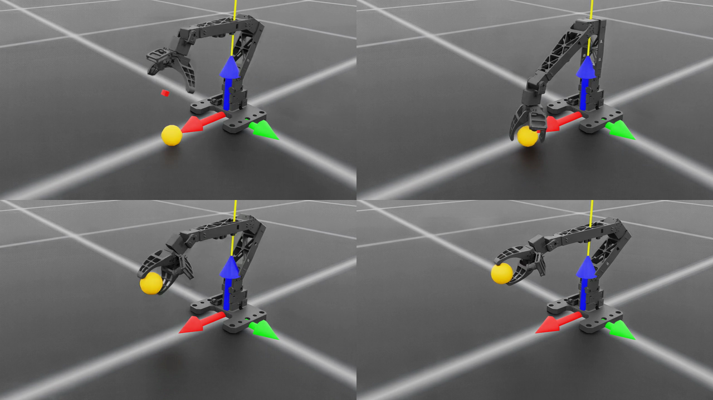

# Ball pickup trained with real-world variation, 2026-11-24

The pickup task retrained on the vendor's servo model, with every simulated arm, ball and camera different, and then checked in a second simulator.

**Verdict: not ready for a real arm.** In the simulator it was trained in, this policy lifts the ball in about 92% of attempts whatever the servo stiffness. In a second simulator it lifts the ball in 72–86% of attempts and then drops it in almost all of them. A policy that cannot keep hold of the ball in a second simulation should not be expected to on hardware.



Videos: [pickup.mp4](pickup.mp4) is Isaac Lab, three attempts, of which the first knocks the ball away and the next two succeed. [mujoco-pickup.mp4](mujoco-pickup.mp4) is MuJoCo, three attempts, showing the ball lifted and then lost.

## What changed from the first pickup policy

| | [First policy](../2026-11-24-first/README.md) | This one |
| --- | --- | --- |
| Servo values | Data-sheet estimates | The vendor's MuJoCo model (which labels its own gains approximate) |
| Simulated arms | All identical | Each with its own servo stiffness (0.12–1.5× vendor), damping, rotor inertia, command delay (0–66 ms) and servo profile time (0–80 ms) |
| Ball position given to the policy | Exact | As a camera would report it: 1–3 steps late, up to 1 cm off for the whole attempt, up to 4 mm of jitter, sometimes frozen near the gripper |
| Ball | 5 g, friction 1.0, damped so it rolled reluctantly | 3–46 g, friction 0.5–1.2, rolls freely |
| Arm commands | Target angle = start pose + 0.5 × output | Target angle = present angle + 0.2 × output |
| Value estimate during training | Same inputs as the policy | Sees the ball's true position |

## How it was produced

- Isaac Lab 3.0.0 with Isaac Sim 6.0.1, PhysX, one NVIDIA L40S, 4,096 simulated arms.
- 1,250 PPO iterations with the damped ball (seed 44), then 2,200 more with the freely rolling ball (seed 45), resumed from the first. 3,450 iterations in all, about 66 minutes.

```sh
$ISAACLAB_PATH/isaaclab.sh -p scripts/check_pickup_scene.py --headless
$ISAACLAB_PATH/isaaclab.sh -p scripts/isaaclab_run.py train --task Understudy-Pickup-Ball-OMX-v0 --headless --max_iterations 3450
$ISAACLAB_PATH/isaaclab.sh -p scripts/evaluate_pickup.py --headless \
    --checkpoint logs/rsl_rl/understudy_pickup_omx/<run>/model_3449.pt --output results/pickup/<name>
python scripts/mujoco_pickup.py --policy results/pickup/<name>/policy.onnx --attempts 200
```

## Results in the training simulator (Isaac Lab)

5,000 attempts per row, scored on the final half second of each five-second attempt. "Lifted" means the ball's centre is more than 5 cm above the desk. "Held at target" means lifted and within 3 cm of the target point.

| File | Condition | Lifted | Held at target |
| --- | --- | --- | --- |
| `evaluation.json` | Everything varied, as in training | 92.1% | 24.1% |
| `evaluation-stiffness-x0.12.json` | Arm servos at 0.12× vendor stiffness | 93.4% | 26.5% |
| `evaluation-stiffness-x0.3.json` | 0.3× | 93.7% | 25.6% |
| `evaluation-stiffness-x1.json` | 1× (the vendor value) | 91.9% | 22.6% |
| `evaluation-stiffness-x1.5.json` | 1.5× | 89.7% | 21.6% |
| `evaluation-camera-exact.json` | No fixed camera error | 94.1% | 24.7% |
| `evaluation-camera-2cm.json` | Fixed camera error up to 2 cm | 72.5% | 17.8% |
| `evaluation-mass-46g.json` | Every ball 46 g | 45.2% | 15.4% |

- Servo stiffness no longer matters much: 90–94% lifted across a 12-fold range. The first policy fell from 100% to 6% over a 6-fold range.
- It is imprecise about where it holds the ball: typically 4 cm from the target, so only about a quarter of attempts end within 3 cm. The first policy managed 89% in its own easier conditions.
- It is weak with a heavy ball (45% at 46 g) and with a camera more than 1 cm out.

## Results in a second simulator (MuJoCo, vendor arm model)

200 attempts per row, run through `understudy/runner.py` in servo units, with the vendor's 50 ms servo profile and a 15 ms command delay.

| File | Condition | Lifted at some point | Still lifted at the end | Held at target |
| --- | --- | --- | --- | --- |
| `mujoco-vendor.json` | Vendor settings, camera errors on | 71.5% | 3.5% | 0% |
| `mujoco-camera-exact.json` | Exact camera | 85.5% | 3.5% | 0% |
| `mujoco-stiffness-x0.3.json` | Arm servos at 0.3× | 82.0% | 6.5% | 1% |
| `mujoco-extra-delay.json` | One more control step of command delay | 64.0% | 5.0% | 0% |
| `mujoco-gripper-half-force.json` | Gripper at half force | 71.0% | 24.0% | 0.5% |
| `mujoco-no-camera.json` | No camera; ball assumed where it was placed | 87.0% | 1.0% | 0% |

- The approach, grasp and lift carry over: the ball leaves the desk in most attempts.
- The hold does not. The ball is pinched between the fingertips, the arm moves quickly, and in MuJoCo the ball squeezes out of the pinch. Halving the gripper force raises the share still held at the end from 3.5% to 24%, which points at the grip, not the arm control.
- Which simulator is closer to a real foam ball is not known. Real foam compresses, which should help a pinch. Until the grasp holds in both simulators, assume the worse one.

## What the second simulator found along the way

Running in MuJoCo exposed three problems that the training simulator alone would have hidden:

1. **Dependence on one servo stiffness** (the first policy). Fixed here by varying it and by commanding joints relative to their present angle.
2. **A ball that was too reluctant to roll.** The training scene damped the ball's motion to imitate foam. With the same damping added in MuJoCo, an earlier version's lift rate at the vendor stiffness rose from 35% to 80%. The ball now rolls freely in training.
3. **A fingertip pinch that only holds in one physics engine.** Not fixed.

It also exposed a bug in the cross-check itself: its simulated servo froze for the length of the command delay whenever a new command was sent, where a real servo keeps following the previous command. That made every delayed policy look worse than it was until it was corrected.

## The earlier absolute-command version

`earlier-absolute-commands/` holds the policy from the first 3,000 iterations of this effort, which commanded target angles from the start pose, with its eight evaluation files. It was trained with the damped ball and command delays up to 30 ms. Lifted: 82.6% with everything varied, 94.4% at 0.12× servo stiffness, 67.5% at 1×, 57.7% at 1.5×. Its weakness at the vendor's stiffness is what led to relative commands.

## What has to happen before a real-arm attempt

1. Make the grasp hold in both simulators: vary the gripper force and the ball-finger contact during training, slow the lift, and consider rewarding a grasp deeper between the fingers than the tips.
2. Measure the real arm's servo response with a step test, which would allow a narrower and more precise policy.
3. Build the camera that reports the ball's position, and calibrate the arm (`scripts/real_arm.py calibrate`, `check`).

## What this does not cover

- No real-arm run. `understudy/dynamixel.py` and `scripts/real_arm.py` have not touched hardware.
- The ball is a rigid sphere in both simulators.
- The vendor model's 0.1 N·m joint friction is not modelled in Isaac Lab (it is in MuJoCo).

## Files

| File | Purpose | How to use |
| --- | --- | --- |
| `pickup.mp4`, `pickup-frames.png` | The policy in Isaac Lab | Any video player or image viewer |
| `mujoco-pickup.mp4` | The policy in MuJoCo | Any video player |
| `policy.onnx`, `policy.onnx.data` | Exported policy | `understudy.runtime.OnnxPolicy`; input `[1, 28]`, output `[1, 6]` |
| `interface.json` | How the arm outputs become joint targets (relative, scale 0.2) | Read automatically by `OnnxPolicy` |
| `policy.pt` | The same policy as TorchScript | `torch.jit.load` |
| `model_3449.pt` | Final training checkpoint | `scripts/evaluate_pickup.py --checkpoint` |
| `params/env.yaml`, `params/agent.yaml` | Task and PPO settings of the final run | Read as YAML |
| `training.tfevents` | Training curves of the final run | `tensorboard --logdir .` |
| `evaluation*.json` | Isaac Lab measurements | Read as JSON |
| `mujoco-*.json` | MuJoCo measurements | Read as JSON |
| `earlier-absolute-commands/` | The earlier version and its measurements | As above |

## Policy interface

Input, 28 numbers: six joint angles relative to the start pose (five arm joints, then the first gripper finger); the same six joints' velocities; the ball's position in the arm base frame; the hold target position followed by the quaternion `0, 0, 0, 1`; and the previous six outputs.

Output, six numbers. Each arm joint's target is its present angle plus 0.2 times the output, clamped to the joint limits. The sixth output opens the gripper if it is zero or more and closes it otherwise. Commands are sent at 30 Hz. `understudy/runtime.py` implements this, and `tests/test_policy_outside_isaac.py` checks it against a recording made in Isaac Lab.
